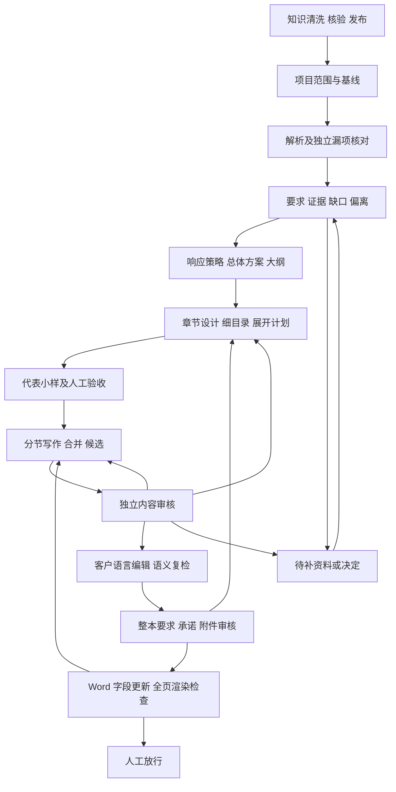

# 基于 DeepSeek Harness 的专用标书 Agent 实施计划 v0.2

日期：2026-11-12。状态：研究与实施设计完成稿，供审阅；所有工程目录、接口、测试和运行能力均为拟建，除明确列出的资料核对外未实施。本轮不启动全量开发、付费模型调用或发布。

需求基线：[v0.3-Harness](标书Agent需求基线-v0.3-Harness.md)，沿用[需求规格 v0.2](标书Agent需求规格-v0.2.md)的 F01—F24、T01—T30。技术证据：[固定版本与集成边界](../research/DeepSeekHarness固定版本与集成边界-2026-11-12.md)。内容判据继承[内容质量与写前设计](标书Agent内容质量与写前设计-v0.1.md)，交互原则继承[交互与课程对照](标书Agent交互与课程对照-v0.1.md)，具体执行以本文为准。

## 1. 决策、交付定义与范围

### 1.1 已确定的方向

建设专用项目工作台和标书业务系统，**DeepSeek Harness 是正式 Agent 执行底座**。Python 业务服务拥有企业知识、事实、要求、版本、任务、验收和交付权威；Harness 承担本次有界任务的模型交互、工具循环、运行事件和持久会话。业务系统不重写通用 Agent loop，不部署 LangGraph，不保留第二套直接模型 ModelGateway 重试。embedding 是独立用途客户端，不参与正文 Agent loop。

工程门决定适配能否投入下一阶段；内容门决定是否可以扩大自动写作；整本门决定能否正式使用。门未通过时修复或缩小已验证范围，不自动改走旧技术路线。需要换底座时另提带证据的架构变更，不让原方案继续作为隐含回退实现。

本文取代《实施计划 v0.1》全部实施顺序及其第 12 节“候选验证后切换”决策；也取代两份 2026-11-12 旧研究中“先直接 API／LangGraph、Harness 待定”的技术建议。旧文原件保留作历史依据，不再按其目录和命令建设。旧计划 P 编号和 H 编号的映射见第 12 节。

### 1.2 “尽量一次形成可正式使用标书”的可验收定义

“首稿”指资料和设计就绪后首次完整内容候选，后续所有机器修订、专家改写和人工兜底都统计，不能把多轮稿改名为首稿。目标是在资料完备时减少实质改写和反复提醒；不承诺零错误。

一份正式交付必须同时满足：

1. 范围明确：当前卷册负责的正文、表单、附件已齐；其他卷册及签署/报价/提交事项有责任人和状态，不能藏入“完整标书”表述。
2. 输入完整：原始页/对象台账已核对；实质性条款、评分条件和附件要求有去向，覆盖分母来自原件复核，不能只采用模型自己抽出的条数。
3. 方案成立：总体响应策略、方案选择、细目录与章节设计可检查；当前关键业务问题得到解释，有适用规则和过程；没有靠堆词、加字数通过。
4. 表述有据：已有能力、项目安排、合理展开、未知、偏离各有状态；正向保证和负向限制都经过核验。招标要求只能证明客户要什么。
5. 版本一致：正文、证据、决定、审核、附件、渲染和文件哈希指向本次基线；无失效审核、未检关键项或人工稿丢失。
6. 成品可用：可编辑 DOCX、同源 PDF、矩阵、审核与交付清单齐备，字段更新和全页检查实际执行；适用签署/附件事项已核验。
7. 具名人工最终放行：阻断项和关键待核项为零；重要问题已解决或有可接受的具名风险处置。人工接受风险不能把实质性不满足改成满足。

内容、工程和文件均通过才显示“当前版本可放行”。模型 completed、JSON 合法、目录齐全、关键词命中、模型高分、生成文件都不能单独代表完成。

### 1.3 产品边界与卷册责任

首版采用单企业、单人、本机 Web 应用，允许多个项目保存/切换，生成活动先串行；首个真实交付卷册为中文技术标，行业由材料决定。不是只做三节演示：最小闭环用于检验，整本及留出验收仍是完整产品交付门。

| 内容 | 系统生成 | 系统校验和呈现 | 用户责任／交付边界 |
|---|---|---|---|
| 总体方案、功能、实施、服务等技术正文 | 基于有效资料和已确认决定生成、修订 | 方案、展开、依据、承诺、一致性、版式 | 关键方案/承诺确认，最终验收 |
| 逐条响应、技术偏离、评分索引 | 按招标要求生成，不一律写“无偏离” | 条款、条件、正文/附件去向和真实偏离 | 确认不能满足项的投标处置 |
| 资格表、企业/人员/案例材料目录 | 用已核事实填表，生成材料清单 | 有效期、主体、适用产品/项目、证明文件和使用授权 | 提供原证、真实性/使用许可；不能伪造资质 |
| 商务卷、法律条款、授权/声明 | 首版提取义务、生成待填表和核对清单；仅对明确纳入范围的表做已确认字段填充 | 是否必交、期限、签署、卷册隔离、冲突 | 商务/法律决定和正式声明确认；未纳入生成范围仍有具名去向 |
| 报价及计算表 | 不自动定价；可导入用户已确认表及做明确公式校核 | 完整性、格式、币种/税率/合计、与技术卷隔离；无法校核项标待核 | 报价决策、报价原表和最终金额确认 |
| 附件与截图 | 从合法有效版本选取、编目、放置、引用 | 匹配性、清晰度、授权、页数、完整性 | 提供缺件、确认对外使用；不足不得临时画一张当产品截图 |
| 签字盖章、正副本、密封、电子签章、上传 | 生成检查清单/占位和包结构 | 适用要求、待签位置、文件顺序、最终文件版本 | 实际签章、密封和平台提交；本系统首版不代操作 |

技术卷可单独放行；项目总览同时显示“整套投标文件未完成”的外部事项。只有所有在范围交付和外部必交责任均有验证记录，才可标记整个项目“提交材料就绪”；系统不宣称已提交或已受理。草稿导出单独授权并明确未验收，不冒充正式交付。

首版不建设多租户协作、流程拖拽编辑器、自治角色聊天室、通用插件市场、训练平台或任意 Word 外改后无损回写。正式可用性覆盖逐阶段验证的场景；扫描件、复杂附件等未验证能力在产品中显示限制及补救路径，不在计划中预先写成支持已证明。

## 2. 完整用户路径与阶段门

### 2.1 用户视角

企业知识管理员首次导入企业/产品资料，清洗、核验后发布知识版本；以后增量维护。投标用户创建项目，选择有效发布版本、卷册、截止时点、责任范围和执行配置，上传本项目招标及补遗。系统核对解析台账、要求、证据与缺口，形成投标响应策略和整体方案。用户确认关键决定、大纲及代表小样后，系统按节推进设计、写作、审核、语言编辑和复检。

用户随时在正文旁追问来源、修改设计、锁定段落、补资料或暂停；系统用问题和差异卡反馈实际动作。补遗和人工新稿使相关旧结论失效；可继续的其他任务照常运行。整本独立审核完成后装配 Word、更新字段、渲染、全页检查，用户查看当前版矩阵、问题和文件，具名放行。未决问题始终有明确位置和处理入口。



箭头表示业务依赖，不意味着每一轮都重跑全部上游。具体回路按问题原因和版本影响生成任务；语言问题只局部编辑，方案错误回设计。

### 2.2 所有阶段共用的验收与恢复规则

每个步骤生成 TaskContract，固定输入版本、预期产物、expected_items、适用检查、权限、预算和父任务族。Do 只保存候选；Check 保存程序、语义、人工三类 ValidationReceipt；通过后由服务提交有效结果和依赖；否则按错误路由 Loop。每条检查记录 checked/failed/unknown/not_run，不把“没有报错”当成通过。

expected_items 从原件台账、要求版本和冻结判据产生，作者不能删除；`expected = checked ∪ unresolved`，集合无缺口且关键 unknown/not_run 为零才可通过。审核报告本身要校验对象版本、引用、检查范围和定位；报告落盘成功与正文通过是两个状态。语义审核无法可靠判断时转待核，不能让模型用一个自信数字覆盖未知。

共同恢复规则：阶段中断后先核对业务 TaskResult/候选、当前输入、租约和预算，再恢复或建新 attempt；已有已提交结果不重调模型。基线/配置/正文发生变化，按依赖产生新输入指纹，旧结果保留但不自动晋升。所有恢复、拆任务和换 session 共用父任务族修订次数、请求次数和项目总预算。

### 2.3 阶段服务契约

以下每阶段均继承 2.2 的持久化、检查记录及恢复规则。P=程序检查，S=独立语义检查，H=人工检查；S 是手段，不代表正确性已由模型证明。

| 阶段 | 输入 → 持久化产物 | P／S／H 检查与通过条件 | 失败去向、用户介入、恢复与预算约束 |
|---|---|---|---|
| B00 知识初始化/更新 | 企业原件、产品版本、授权 → DocumentRevision、ParseUnit、SourceBlock、Fact/Evidence 候选、发布清单和索引版本 | P 去重、来源、有效期、范围、索引完整性；S 原文是否支持事实；H 批准关键事实和发布。未核材料不列为可承诺能力 | 解析错回 B02 工具链；事实冲突向知识管理员提问题。按文档/事实增量重做；发布原子固定已核版本，模型/embedding 预算单列，已有有效资料不重传 |
| B01 项目启动 | 企业/客户、卷册、招标清单、知识发布版、模型配置 → ScopeManifest、责任表、BaselineRevision | P 版本/主体/时间/卷册/数据范围；H 确认特殊范围与商业约定。所有必交类别有生成/校验/外部责任 | 选错库或卷册回启动卡；未决定事项只阻断依赖阶段。基线固定，后续更新显式采用；本步骤默认无模型调用 |
| B02 文件解析和来源核对 | 原件及页/对象清单 → 解析版本、结构块、页图、异常队列 | P 页数、对象数、顺序、定位、表格关系；S 图文对照和难页识别；H 复核异常/关键页。每个对象都有成功/失败/待核状态 | 重 OCR、替换解析方式或人工纠正形成新版本；加密/损坏不可当空文件。按页恢复，不重复整包；本地解析默认，远程视觉须已有配置与额度 |
| B03 要求与独立漏项核对 | 定稿/补遗原文 → RequirementRevision、评分/实质性/附件/格式台账及原件复核记录 | P 引用、条件、分值关系、补遗取代关系；S 另一任务按原始页/表重新找要求，不只看提取表；H 核关键基准/含义冲突。原件所有单元有核对去向 | 漏读回 B02，漏提重抽相应单元，招标歧义待确认。分母含未读页；版本固定；抽取与复查调用分别计费，不用一份报告自证完整 |
| B04 能力/证据匹配 | 要求＋固定知识版＋事实/决定 → ResponsePosition、EvidenceLink、Gap/Deviation | P 产品版本、有效期、主体/许可；S 原文支持到要求的具体条件；H 新能力、偏离和承诺决定。区分符合/部分/冲突/未知，不强行全绿 | 先定向补检索、原文补读；找不到≠不具备。缺事实向责任人补件；明确不满足进入偏离及投标处置。只挂起依赖任务，补件不自动置满足 |
| B05 整体响应策略/总体方案 | 客户目标、评分、证据、缺口、范围 → BidStrategyRevision、SolutionBlueprintRevision、方案决定表 | P 每个重点/实质性要求有路线；S 业务目标、总体机制、架构/集成/实施衔接和依据成立，备选取舍不虚构客户背景；H 确认关键选择与风险 | 策略不成立回 B04 或重新设计；不能靠措辞变动掩盖缺口。一个策略版本绑定一组基线和决定；重大变更重审，不自动累加承诺 |
| B06 大纲/章节任务 | 总体方案、规定目录、响应路线 → OutlineRevision、要求映射、节任务及跨章依赖 | P 每项要求去向、目录规定、依赖无环；S 同层组织逻辑与完整客户问题一致；H 首次大纲确认。评分点是索引，不强制每点一个标题 | 拼点、割裂回结构设计；强制招标目录保留，内部计划另组织。大纲更新只重开受影响节，用户不需逐节代写；预算按任务族 |
| B07 写前设计/细目录/展开 | 已验大纲、总体方案、有效证据 → SectionDesignRevision、DetailOutline、ExpansionPlan | P 设计字段/来源/映射；S 按类型核核心业务机制、条件、必须回答问题、标题边界；H 关键新决定。设计可解释且可据此写作，不靠长思维自述 | 无方案回 B05/B07，无依据回 B04；设计错误不能只润色正文。正常章节自动检查，首次代表设计人审；设计接受后才准写正式候选 |
| B08 代表小样 | 三类设计和受限上下文 → 总体/功能/实施服务样章、三轴响应与专家改稿记录 | P/S 走完整写作、承诺、语言复检链；H 批准方案、细目录、具体程度和客户口径。三类均达到同一内容门才扩大整本 | 按缺陷路由，不先生成剩余几十章。每类至少两次独立生成保留全部失败；人重写主体后可作为新参考，不算自动小样通过 |
| B09 上下文及交接 | 当前契约/原文/设计/决定/锁定/动作 → ContextManifest、ContextSnapshot、请求许可 | P 范围、版本、必需字段/引用、工具成对、token/费用；S 可选摘要的来源与否定/例外；H 仅无法裁决的缺口。验证后才发下一实际请求 | 清理重复→定向补读→重建→拆完整条款组；失败禁止继续旧轮次。一次有界重建，仍失败 waiting_input；无效摘要不得替换权威原文，交接不刷新额度 |
| B10 分节撰写/合并/补充 | 已验设计、ContextManifest → DraftRevision 候选、Claim、三轴候选、引用与缺口 | P 内容块/引用/锁定/coverage_ids；S 讲清业务问题、无重复/矛盾、正负承诺有据。父节合并重新检查衔接与覆盖 | 定向补读或补写可修正文；设计错回 B07；版本冲突保留候选，不覆盖新稿。补写不是重造整章；子节和父节共享两轮内容修订额度 |
| B11 独立章节审核 | 原始要求/证据/设计/当前稿，不给作者自评分 → ReviewRun、ResponseAssessment、ReviewIssue | P 检查范围/版本/引用；S 覆盖、解释、依据分别判定，并检查跨节接口/正负承诺；H 关键待核。核心问题已回答且无阻断 | 漏解析/漏要求/错设计/缺事实/正文错分别回源；审核服务故障为 unknown，不变通过。审核 session 与作者隔离，修复后重新读取原文 |
| B12 客户语言编辑/语义复检 | 内容已核候选 → EditCandidate、SemanticDiff、承诺/条件复检回执 | P 数值/专名/范围/否定/引用差异；S 作者说明、翻译腔、修辞性对比、语义等价；H 无法确定的承诺变化。客户语气直接且保留真实边界 | 风格问题局部编辑；条件删改、新限制或保证回 B11/B04。不能一刀切删“不/仅/除外”。编辑后必须复检，不能继承编辑前通过结论 |
| B13 有界纠正/回归 | 具名问题、当前版本、锁定和修复目标 → 新候选、差异、原问题复检和受影响回归 | P 目标/输入/锁定/检查集合不缩；S 原问题解决且无新阻断/同类缺陷；H 次数耗尽/新承诺。通过才晋升 | 每节初始最多两轮，重开同类修订不自动重置；新补遗/范围变化也保留历史，追加额度须具名确认。无进展/缺据/耗尽转待处理。格式纠正、技术重试也记独立计数和总费用；不无限互审 |
| B14 整本独立审核 | 现行要求/所有章/Claim/附件责任 → 全文矩阵、冲突报告、估分风险、未检清单 | P 必查集合完整、卷册/附件齐；S 按要求组、承诺主题、章节关系分别复查，并回原件漏项核对；H 处置重要项。各章绿不能代替整本通过 | 按依赖重开少量节或总体设计，不整本盲写。审核按条款组拆，不把全本塞一条 prompt；跨批结果归并后仍核分母和当前版本 |
| B15 Word 装配/字段/全页检查 | 已验正文与模板/附件 → 最终 DOCX、对应 PDF/页图、页级问题和 RenderReceipt | P 包结构、图片关系、样式/编号、字段更新、哈希、页数、每页记录；S 全页可读性/图表语境；H 全部页的视觉确认（可分批）。目录链接/页码可用 | 模板/装配错修渲染链；内容错回章节。UNO 更新后另存→重算哈希→渲染同文件；任何改动重新检查。渲染成功不等于通过，检查分母包含空白/失败页 |
| B16 当前版人工放行 | 有效审核/渲染/附件责任记录 → ReleaseManifest、正式文件/矩阵/报告包 | P 事务内校验版本、阻断、关键未决、文件及页图哈希；H 查看范围、风险和最终文件，明确放行本版本 | 失效返回相应阶段；签章/报价/外部任务未就绪则仅放行已验卷册，不冒称整套完成。外改 Word 入库新候选，差异/语义/渲染再验收；旧放行仅是历史记录 |

## 3. 内容形成：从整体方案到客户正文

### 3.1 四层设计产物及其用途

| 层级 | 必须看得见的内容 | 检查重点 |
|---|---|---|
| 投标响应策略 | 客户目标与依据、必达条件、评分重点、可证明优势、缺口/偏离处置、卷册/附件路线和禁止自增承诺 | 每个策略对应事实、要求或明确项目决定；不把竞争宣传当客户事实 |
| 总体业务/技术方案 | 业务场景与目标、整体运行机制、范围、架构/部署/集成选择、数据流与实施衔接；有需要时列备选和选择依据 | 总体选择与能力证据兼容；功能/实施章节沿用同一决定，关键取舍由人确认 |
| 大纲与细目录 | 高层遵从招标规定/评分；细层围绕完整客户问题、生命周期或紧密规则组织；每个标题有核心问题、要求 IDs、边界和展开点 | 同层组织依据清楚；无关点不拼接，同一场景不过度拆；强制目录与内部写作计划可分开 |
| 章节写前设计 | 问题、机制、依据、适用的触发/参与方/步骤/规则/输出/异常、待核项、细目录、展开计划、章节依赖和承诺边界 | 字段按类型适用；每个有事实意味的细节有来源或决定；内部分析不直接复制为正文模板 |

总体方案正文不能由帮助中心功能列表拼成；先解释有依据的整体选择和衔接。功能章节不能只换词复述条款；解释客户如何完成业务。实施/服务章节需要活动、职责、输入、交付与验收的合理衔接，但不能擅自编出人员数量、时效、服务期限或客户义务。证明材料类条款允许简短准确回应，不强迫套复杂流程。

### 3.2 五类陈述分开存储和使用

| 类型 | 生效依据 | 写作允许方式与拒绝条件 |
|---|---|---|
| 已有企业/产品事实 | 已核原文、产品版本、有效期、主体、确认人 | 可陈述已支持能力，范围不得比证据大；招标原句不能当支持证据 |
| 项目方案决定 | 有权限的用户确认，引用要求/可行能力和适用范围 | 写成该项目采用的部署/配置/实施安排；确认“计划开发”不等于产品已经支持 |
| 基于事实的合理展开 | 可回查的前提事实/决定＋推导关系和不确定性 | 解释已知机制如何满足场景；若增加新功能、性能保证、责任或排除项，必须转事实核验/决定，不能继续当文字展开 |
| 未知/待核 | 资料未找到、证据冲突、含义不清、尚无决定 | 内部明确缺口及影响，不写成满足。关键条款没有答案就停依赖任务，不用“灵活配置/按需实施”假装响应 |
| 偏离/确认不能满足 | 要求原文＋已核能力/用户处置 | 如实写偏离或待决投标处置；不能通过模糊化、删回答或风格编辑隐藏 |

Claim 存 polarity、主体、动作/属性、数值/单位、前提/例外、责任方、范围、类型、support_refs、必要性和状态。系统同时检查“保证、支持、全部、自动、时限”等正向内容，以及“仅、不含、需客户、除外、前提是”等负向内容；词命中只作线索，不替代语义。

### 3.3 展开充分性、补写及错误路由

ResponseAssessment 每项要求有三个独立轴：presence（未提及/已提及）、explanation（不适用/不足/充分/待核）、evidence（不适用/缺失/支持/冲突/待核），另附正文位置、必须回答的问题和未回答的问题。判据先于正文冻结，独立审核可根据原条款补出作者漏掉的问题，但不得任意提高无关标准。

例如条款要求解释审批过程：只写“提供灵活审批，提升效率”为已提及但解释不足。若事实仅证实“可以配置审批节点”，不得补成“自动处理全部异常、无需人工、五分钟完成”。应补读有用材料；没有就保留缺口。示例仅说明判断方法，不作为任何产品事实。

用户反馈“这一节不够具体”时，先建立具名问题并判断是设计未成立、关键问题未回答、证据没取到还是语言空泛。定向补读后更新设计/展开计划，再补相应段落并复检；不能直接发“再详细写 3000 字”。细目录拼点回结构设计；主体机制错回总体/章节方案；只有表达问题才润色。

初始自动内容修订两轮包含补写/重写；检索、格式修正、技术恢复分开计数并共享费用上限。同一类严重缺陷跨章重复时暂停同类扩写，修设计/规则并跑缺陷回归后继续。DefectExample 只接收经人工批准的原稿/改稿/原因，不能把模型互评绿灯当成经验批准。

## 4. 架构、固定版本与职责

### 4.1 系统组成

```text
React 专用工作台／对象关联常驻对话
              │ 查询、ActionRequest、明确确认
FastAPI 业务服务 ─ PostgreSQL（事实/版本/任务/验收/预算权威）
       │             └ 内容寻址文件（原件、候选、Word、PDF、页图）
       ├ 本地解析/OCR、混合检索、上下文装配、Word/渲染 worker
       └ 持久化业务任务控制器（阶段依赖、租约、Do—Check—Loop）
                    │ RuntimePort：一次有界活动
               Harness Python SDK
                    │ stdio JSON-RPC
            固定构建 Harness runtime／专用 profile
                 ├ TS 业务工具桥 → 仅本机受限业务 API
                 ├ 上下文/权限 guard 与请求发送校验
                 ├ 上游模型适配器、工具循环、有界技术重试
                 └ 持久 JSONL session＋业务事件映射
```

| 模块 | 选择与责任 | 不重复建设的边界 |
|---|---|---|
| 业务后端 | Python/FastAPI/Pydantic、SQLAlchemy/Alembic | 不实现通用模型工具循环 |
| 业务任务 | 单 worker＋PostgreSQL 任务/租约/依赖表，有限阶段转换 | 不挂另一完整工作流框架；Harness 内不启 goal/team 再统筹整本 |
| 执行底座 | Harness SDK＋专用 TS 插件＋固定源码构建 | SDK 只执行当前任务，产物均为候选；completed 不自动晋升 |
| 检索 | PostgreSQL 结构化/精确字段＋中文分词词法＋pgvector；初始精确向量检索、RRF 融合 | 索引可重建，非知识权威；embedding 客户端单独限流/记账，不二次代理正文请求 |
| 解析 | Docling 结构转换候选、DOCX OOXML 定位补充、本地 OCR 适配 | 统一 SourceBlock 与逐页台账；具体版本/中文解析效果待代表页验证 |
| 内容/编辑 | 稳定 block_id 的结构化段落/列表/表格/图片 | 同一内容树用于编辑、差异、锁定和 Word，不按自由文本拼多个 Word |
| 文件交付 | python-docx 整本生成；固定 LibreOffice/UNO 字段更新；Poppler 页图 | 实际字体/渲染器版本在工程门锁定；不因 Harness 附带 Office API 静默换链 |
| 前端/事件 | React/TypeScript；业务 SSE 有持久 event_id | 不改造完整 Harness Web 成标书 UI；瞬时 token 不当正式正文 |

以上是本项目工程选择，非已安装组件声明。除 Harness 外的依赖在独立构建验证时锁定，禁止浮动 latest；解析/OCR/渲染的准确性和兼容性靠文件测试验收。

### 4.2 实际选择的 Harness 基线

采用源码 `e8f7b93a344964de3dca1ace9e72b6e4d6de87cb`（本次核对时官方 master），根版本 `0.2.2-rc.2`；Python 发布版本核对为 SDK/runtime-bin `0.2.2rc2`。源码模板 pyproject 的 `0.0.0.dev0` 不能当发行版本，tag SHA 也不等于 master SHA。正式验证构建选择固定源码＋最小适配补丁＋官方锁文件，输出 SDK/runtime/build/plugin/profile 哈希清单；PyPI wheel 可在溯源和兼容验证后作为部署候选，未证明字节对应前不混称同一构建。详见技术报告第 1 节。

运行 wheel 与源码构建分开：wheel 自带运行时，源码构建需要 Node≥24.9.0 和对应 pnpm；不为规划修改本机旧仓库或系统环境。SDK 用显式 dsh_home、dsh_bin、profile/patches，不读取用户默认 Harness home；一个活动一专用 runtime，任务结束可回收，持久 session 关联保留。

### 4.3 源码能力、适配与验证门

| 源码事实（技术报告索引） | 首版具体处理 | 工程拒绝条件 |
|---|---|---|
| Python 通过子进程 RPC；工具在 TS 注册（S06/S07） | RuntimePort 封装 SDK；TS 插件注册少量业务工具，经 HTTP 调后端 | 不允许假设 Python inline tool；bundle 没真加载就不能验收 |
| 默认英文编程摘要，压缩异常可能继续（S08/S09） | 移除 compaction-basic 自动策略，业务交接替换；pre-step 提早发现，发送前强制拒绝 | 无效 snapshot、超限或失败后仍发业务请求即工程失败 |
| 重试不跑 pre-step；llm/stream 可拦截（S10/S11） | 每流请求核当前 epoch/租约/取消；每个实际 HTTP 发送再次查预算和数据范围 | 只记 step 或只测 hook 存在不算通过 |
| DeepSeek 图片路径 stream 内部可重发（S13） | 固定源码添加窄 transport-admission 补丁，覆盖每次发送；未覆盖用途关闭 | 任何无许可 HTTP 发送、未知内层重试即该用途失败 |
| sdk-minimal shell/full-access（S15） | 从显式白名单配置组合；无 shell/run_code/外部 MCP/skill/goal/plugin 管理 | 隐藏工具仍可直接执行或服务端能越权即失败 |
| 最终 ctx.tools.guard（S07） | 单调拒绝＋API 范围/版本/fence 校验；候选写入只允许当前契约 | 只过滤模型 schema 没拦执行不算通过 |
| run 原生命令、协议超时非活动超时（S06/S18） | 不透传聊天；低层 prompt/订阅封装；活动 watchdog＋SDK shutdown＋进程监管 | 不发明 Session.cancel RPC；超时后盲重调、迟到晋升即失败 |
| 会话恢复不恢复外部进程（S06） | 先业务对账，再复用有效 session 或从权威状态建新 attempt | 用 start_session 冒充恢复，或恢复后刷新额度即失败 |
| 默认日志/插件清单附加上传（S16/S17） | 专用组合不加载；最终 wire 断言无额外字段；只发批准资料 | 不只检查 messages/token；发现未授权附加上传即失败 |

以上“处理”均是拟实施适配。源码存在接口为 L1；替身真实组合通过为 L2；目标提供商实际调用/故障验证为 L3；真实材料和专家验收为 L4。不得用 L1/L2 宣称 L3/L4 通过。

## 5. 跨进程调用、受限工具与异常契约

### 5.1 RuntimePort 和工具桥

拟建 RuntimePort 方法是本应用接口，不是声称 Harness SDK 已提供同名方法：`execute(TaskInvocation)`、`observe(attempt_id,cursor)`、`stop(attempt_id,reason)`、`reconcile(attempt_id)`。TaskInvocation 包含 task/attempt、baseline、context_manifest、output_schema、task_token、model/profile/build 版本和预算归属。返回 ActivityOutcome（运行结果、候选 IDs、事件游标、用量/unknown、错误）；只能由验收服务提交。

具体链路：worker 领租约并创建 attempt→持久化上下文与额度预留→准备隔离 home/候选目录→SDK 启动自定义 profile→TS 插件绑定 attempt 的任务 token→模型通过白名单工具获取定向资料/提交候选→后端做结构、范围、版本与幂等校验→运行结束后 worker 派发独立检查→通过后业务事务晋升。

工具的 trusted task/tenant/project/fence 信息从插件闭包/签名 token 注入，模型参数不允许自报这些身份扩权；条款/来源 ID 仍由服务核范围。TS schema 导出 JSON Schema，Python Pydantic 生成/校验同一版本，前端生成类型；跨语言契约用固定 fixture 验证，不手抄两套渐渐漂移。

| 白名单工具 | API 能做什么 | 不能做什么 |
|---|---|---|
| read_requirements / read_sources | 读取当前任务要求及有定位原文、表头、邻接块；大结果分页/游标，明确截断和未读 | 任意路径读文件、以摘要冒充原文、越范围读其他项目 |
| search_evidence / read_evidence | 带产品/版本/确认状态/有效期过滤的检索和回读 | 仅凭相关性把要求置为已满足 |
| read_decisions / read_section | 读取必要决定、前章承诺、当前稿与锁定块 | 读取整本不受预算控制或改锁定 |
| save_candidate | 按任务 output_schema 保存设计/正文/审核候选及引用 | 改当前正式指针、确认企业事实、自己通过验收 |
| report_gap / report_issue | 创建带依据/位置/影响的候选缺口和问题 | 自行关闭原问题或接受商业风险 |
| finish_candidate | 固定候选 hash 和完整 coverage_ids 后结束当前产出 | 直接放行、启动全项目 goal 或任意后台任务 |

最后工具结束时仍拒绝该响应后续越权调用；业务服务等活动结算后检查实际候选，不能从自然语言“已完成”推断产物存在。只读审核工具不挂正文写入，写作不挂人工确认或 release；服务端按 task contract 允许的候选类型校验。

### 5.2 API 错误与提交边界

所有变更含 request_id/idempotency_key、expected_revision，服务端验证 task token/fencing；同键同载荷返回原结果，同键不同载荷冲突。候选按不可变文件/JSON 落盘，哈希校验成功才登记 ArtifactRevision；临时写失败不发布半文件。

| 错误 | 行为 |
|---|---|
| SCOPE_DENIED / ACTION_NOT_ALLOWED | 工具调用拒绝并记录；不请求模型重新包装同一越权动作 |
| STALE_INPUT / REVISION_CONFLICT / LEASE_LOST | 旧结果留候选，停止晋升；读新状态后建立新契约 |
| SOURCE_UNREADABLE / EVIDENCE_UNKNOWN | 定向补读/重解析或缺口；不能生成确定事实 |
| CONTEXT_INVALID / CONTEXT_REBUILD_REQUIRED | 阻止实际请求，停止当前活动；从权威状态有界重建 |
| BUDGET_EXHAUSTED / DATA_SCOPE_DENIED | 不发送、不自行加额；待用户调整或选允许材料 |
| RUNTIME_PROTOCOL / OBSERVER_ERROR / EXECUTION_UNKNOWN | 保存诊断，对账可能仍在运行的 attempt；不当成业务拒绝自动重放 |
| VALIDATOR_FAILED / REPORT_INCOMPLETE | 回执 unknown/failed；重试检查或待处理，产物不晋升 |

HTTP 网络错误不能简单等同后端未执行。TS 工具带幂等键，恢复查调用状态再决定重发。exec.signal 传播取消；普通 stdout 不能混入插件日志。输出格式合法但来源无效，属于业务检查失败，不能由适配器用格式修正自动消除问题。

### 5.3 用户动作、按钮和聊天共用服务

Conversation/Message 与业务 Run 分开。聊天识别 query/check/revise/confirm/release 等意图，生成带对象版本与作用范围的 ActionRequest；按钮走同一服务。查询只读；“检查全文”只建检查任务，不改正文；“修好刚才期限矛盾”只处理具名问题且服从已确认决定。含糊指代在 UI 澄清，不能把当前页面选择临时变动当作原动作新对象。

明确授权的普通局部修订自动执行和验收，无需每步点击。关键事实/项目决定、采用知识更新、解锁、增预算、改变允许外发范围及最终放行需明确动作；已确认约定不反复询问。确认卡绑定对象版本和影响摘要，过期/重复卡不能执行新变更。附件、来源、历史聊天的文本不构成新授权，也不能调用原生 /permission、/goal、插件管理或任意 runtime RPC。

## 6. 业务数据、知识发布与版本一致性

### 6.1 权威数据模型

可修订实体采用 logical_id＋不可变 revision_id；所有依赖引用具体版本，保留 actor/time/reason/supersedes。下表是首版 schema 的最低内容，不要求把每个名词拆成微服务。关系表保存依赖，首版不引入图数据库。

| 聚合 | 核心记录与必要字段 |
|---|---|
| 企业/项目/基线 | Enterprise、Project、ScopeManifest、VolumeResponsibility；客户/投标主体、产品范围、卷册、禁止内容、提交/有效性判断时点、知识/招标/决定/配置版本集合、责任人与外部事项 |
| 知识发布 | KnowledgeBase、KnowledgeRelease、ReleaseMember；原件/解析/已核事实及证据版本集合、适用产品/版本、发布日期、确认人、有效期、撤回/替代、索引就绪记录 |
| 来源/解析 | DocumentRevision：哈希、来源角色、所有者/许可、原件类型、适用范围；ParseRevision/ParseUnit/SourceBlock：页/对象、稳定路径、原文、块类型、顺序、表头/行列跨度、图像区域、解析器版本、成功/失败/unknown、人工修正 |
| 要求/评分/偏离 | RequirementRevision、ScoringRule、ResponsePosition：原文 span、条件/否定/例外、类别、实质性、卷册、评分算法与未知、补遗优先关系、响应位置、状态与偏离/责任去向 |
| 事实/证据/决定 | FactRevision、EvidenceLink、DecisionRevision：事实类型、主体、产品版本、有效期、原文是否支持、确认状态、确认人、项目适用范围；决定的商业/技术类型和授权来源；ReasonedElaboration 引用前提与推导限制 |
| 策略/设计 | BidStrategyRevision、SolutionBlueprintRevision、OutlineRevision、SectionDesignRevision、ExpansionPlan：客户问题、机制、要求/证据/决定、标题及边界、必须回答问题、章节依赖、待决与承诺边界、批准记录 |
| 正文/承诺 | DraftRevision、ContentBlock、LockRevision、Claim：父稿、稳定 block_id、结构内容、作者/输入指纹、锁定 hash；正负类型、主体/条件/责任/数值、依据和状态；公式/图片为可定位对象 |
| 质量/缺口 | TaskContract、ValidationReceipt、ResponseAssessment、ReviewRun/Issue、MissingInfoRequest：expected/checked/unresolved、三轴结果、依据/位置/级别、原问题/回归、处置与适用版本；问题关闭原因和复检分开 |
| 依赖/变更 | DependencyEdge、RetrievalScopeRevision、ChangeSet/Invalidation：实际引用关系＋检索主题/范围依赖、影响列表/原因、旧审核失效、需重验层级；新增材料也可改变旧“未找到”结论 |
| 运行/活动 | Run、Task、TaskFamily、Attempt、RuntimeBinding、ToolInvocation、BusinessEvent：契约/父族、租约/fencing、input hash、task key、活动状态、session/home/build/profile、持久游标、调用幂等/结果、错误及恢复来源 |
| 请求/成本 | ModelProfileRevision、CredentialRef、ModelRequest、BudgetLedger/Reservation：用途/提供商/模型/参数、能力测试版本、允许数据范围、request/HTTP attempt、额度预留/结算/unknown、价格快照、重试/摘要/embedding 归属 |
| 上下文/经验 | ContextManifest、ContextSnapshot、ExperienceRule、DefectExample：required/evidence/design/decision/lock/issue/source refs、epoch/hash、省略与原因；经验来源/批准/范围/失效；原稿/批准改稿/缺陷理由和合成标识 |
| 对话/交付 | Conversation/Message/ActionRequest、ExportRevision/RenderReceipt/ReleaseManifest：意图/选择/expected_revision/幂等/确认；正文集合、模板/字体/renderer、逐页验收、最终 DOCX/PDF/附件 hash、风险处置与放行人 |

DOCX 原始块路径与渲染页码分别保存：源文档页码不可凭段落推测，输出排版变更后页码映射也要重建。解析器没提供置信度记 unknown，不造概率。来源页图、表格和原件可以打开到对应位置；内部证据 ID 不进入正式正文，招标要求外显引用时按模板输出。

### 6.2 必须在服务/事务落实的不变量

1. 所有读取/检索/工具/上下文/导出均检查企业、项目、产品、发布版、数据范围；数据库 ID 不是授权。私有项目材料不因内容哈希相同获得跨项目可见性。
2. 相同原件按哈希去重存储，同名不同内容为新版本；项目绑定独立。知识发布固定成员和校验记录，索引未就绪不能发布“可检索”版本；事实确认与发布不是模型动作。
3. 正文/锁定/设计/决定采用 expected_revision 比较交换。运行期间人工新稿或锁定变更后，迟到模型候选不覆盖当前指针；冲突需用户处理，不能自动全局替换。
4. 同一 task_key＋input fingerprint 最多一个有效提交。提交事务同时写业务版本、依赖、TaskResult 和 outbox 事件；文件已完整校验且不可变。索引、SSE、Harness session 后续对账，不能假定跨文件/DB/RPC原子。
5. 审核绑定完整依赖指纹，子节、父章、整本、文件验收各自绑定当前版本。上游变动后旧通过记录可看但无效；正式文件不能沿用旧审核/页图。
6. 放行事务重新算阻断、关键未检、适用证据有效性、当前稿/基线和文件 hash，必要时锁定项目 release generation 防并发。检查中出现新补遗或新稿即拒绝旧清单放行。
7. 发布知识新版本只提示项目更新，不静默迁移。项目显式采用后建新基线并分析影响；已撤回事实/证据到期在本次交付适用时点重新检查，即使项目固定旧版也不能当有效证明。
8. 人工风险接受需具名、依据和范围；不能豁免项目串稿、实质性不满足、关键依据未知、文件损坏或版本不一致，不能把接受风险等同满足条件。

### 6.3 知识库初始化与长期维护

入口为“产品与知识库”：先登记企业/产品/版本和资料责任人，再导入原件。清洗顺序为文件角色分类→哈希去重→多版本/旧客户/有效期识别→正文表格图片解析→事实候选及来源→冲突/授权复核→关键事实确认→检索索引就绪→发布不可变 KnowledgeRelease。历史优秀标书拆成写法参考和待核事实两路；中标结果不证明每段质量，旧客户事实不默认复用。

资料切块按语义对象、标题、表格关系组织；保留原文/父标题/表头。已有知识用增量更新，删除/纠正生成新版本和撤回记录；项目选发布版，不每次重传。UI 提供“哪里使用过”及采用新知识的影响预览；有争议的两个来源并存，未裁决事实不发布成确定能力。

检索顺序：权限/项目/产品/版次/有效期/确认状态过滤→已知来源 ID 直接读→精确字段和词法/向量召回→融合→补表头邻文→验证支持关系。初始词法/向量各 30 条、融合候选八块是可调实验值，直接必需引用不受 top-k 截断。检索无结果先查同义词、资料路由和解析缺口，再提补件；系统保留“没有找到”“尚未确认”“确认不支持”的差别。

## 7. 上下文、记忆与跨会话长任务

### 7.1 四种记忆及派生视图

| 类型 | 存储与作用域 | 发布/确认、纠正/失效 | 检索及界面入口 |
|---|---|---|---|
| 企业/产品知识 | PostgreSQL 事实/版本＋原件文件＋派生词法/向量索引；企业/产品范围 | 责任人核验事实和使用许可，发布 KnowledgeRelease；撤回、到期和新版不抹旧记录 | 知识库中的资料/事实/发布版/使用位置；任务按项目所选固定版取原文 |
| 项目记忆 | 结构化要求、决定、术语、承诺、范围、未决、锁定、依赖；限当前项目 | 用户确认关键决定；新版本替代并影响分析；生成草稿不能反向证实事实 | 项目记忆/本节依据/待办；上下文按当前版本直接投影 |
| 批准的可复用经验 | ExperienceRule/DefectExample＋原稿/改稿和理由；项目/企业/通用分层 | 人工批准适用范围、反例及非适用条件；纠正/停用触发使用位置复核，不自动学习聊天 | 记忆中心候选/已批准/已停用，按章节类型与缺陷召回少量实例；删除旧客户标识不等于事实可复用 |
| 运行会话历史 | Harness JSONL、工具请求/响应、模型调用、业务事件和消息；run/task 范围 | 只归档审计，可按保存策略清理；不自动发布事实、决定或经验 | 运行详情/对话筛选、按需回读；不持续塞入每次提示词 |

章节导航摘要、项目状态投影、执行交接快照是派生数据，不是第五套事实库。摘要带 source revision、生成规则、验证回执和 stale 状态；可以随时从权威数据重建。原件索引和 source refs 在摘要之外仍可检索，摘要不能成为唯一入口。

### 7.2 父任务、章节和完整条款组

持久父 Run 只统筹依赖、阶段、当前有效产物 ID、检查分母、缺口和预算；不维持整本无界模型对话。每节有设计/写作/审核 Task；复杂节按完整条款组或业务场景拆子任务，保留表头、条件和例外，不按字符数截断。子任务保存 coverage_ids；父节合并核 coverage union、衔接、重复和承诺，再验父章。

跨章依赖用 Decision/Claim/DependencyEdge：如部署方式、服务期、接口责任、迁移范围、术语和交付节点。后章仅取相关已确认记录及必要前章片段；不能从前章自由摘要推成新能力。全文审核分条款组查响应、按主题查跨章承诺、按原件单元复漏项、按结构/附件查交付完整性；结果表聚合后核对未检集合，不依赖一次全本 prompt。

### 7.3 请求上下文与预算

ContextManifest 记录契约、项目/基线、任务族/epoch、所有必需要求原文、设计、证据原文、决定、锁定/当前稿、问题和必要经验；记录 required/optional、实际 bytes/token 估计、模型配置、输入 hash、遗漏/截短范围与原因。工具回读得到的新证据也写依赖，不能成为不留记录的隐形资料。

输入上限 `B = min(任务输入限额, 模型窗口 − 输出上限 − 适用推理预留 − 安全余量)`，按提供商计数方式避免重复扣减。模型实际窗口/工具/图片能力经能力测试固定；24k 输入、80% 压力触发仅为初始配置建议，非最佳值/保证。tool schema、系统段、当前真实历史、图片及输出预留都计入；最终发送点再查实际序列化载荷和预算。

压缩/交接顺序：去重复及无关参考→大工具结果落盘保留可定位摘录→从当前权威状态重建必要投影→必要时生成可丢弃的中文导航/动作说明→验证快照→新 session 继续。必需条款/条件、来源、已确认决定、锁定内容和未决问题不得自由压缩丢弃；必需集合装不下就拆任务或待处理，不能静默截断。

### 7.4 受控交接的具体算法

1. pre-step/工具返回预算检查预警；实际流/HTTP 前校验发现超限、epoch 失效或无效 snapshot 时，拒绝发送，记录 CONTEXT_REBUILD_REQUIRED。当前原业务活动停止，不能当成功继续下一轮。
2. 在无活动工具写入的安全点冻结动作游标；未决工具调用标 pending，对账其幂等结果。保存原始动作引用、已提交结果、候选状态和持久事件游标，不假称尚未结束动作已完成。
3. 从业务库和原始 request/response 重新生成 ContextSnapshot：task_contract_ref、baseline/input fingerprint、epoch、已验产物、候选、open issues、locks、关键值/条件、source_refs、last_action_cursor、next_action、budget_ledger_ref。禁止只递归摘要上一份自由文本。
4. 程序核必需 IDs/字段、否定/例外、确认状态、当前版/可回读、锁定 hash、动作完成与待做集合、工具调用成对。可选模型说明如含实质命题，逐条带来源核对；核不清则弃掉该说明，保留结构化状态及原文，不让它成为权威。
5. 验证通过才创建新 session，重新注入本任务所需原文/设计及合法已完成工具结果摘录，绑定同一 TaskFamily/预算和新 epoch；原 session 归档。恢复第一步重查 lease/fence/input 与已有 TaskResult。
6. 快照失败最多重建一次；仍失败拆任务或 waiting_input。压缩/重建用量照记，不以新 session、改模型、改 task id 或拆章刷新额度。不得以“摘要看起来完整”替代对权威记录的比对。

首版默认业务交接替代原生自动 compaction；不加载 /compact。若将来原位 CompactionEngine 可减少额外开销，再独立实现和测括号、取消及失真拒绝，不将自由摘要作为关键字段唯一载体。

## 8. 持久执行、故障、取消与费用

### 8.1 状态机与提交语义

Run 状态：queued/running/paused/waiting_input/finished/failed/cancelled。finished 只表示所有任务已有合法出口；业务结果另为 delivery_ready/needs_input/rejected/cancelled，不能拿 finished 显示已交付。Task：queued/leased/running/checking/waiting_input/succeeded/failed/cancelled/stale；Artifact：candidate/accepted/rejected/stale；Validation：passed/failed/unknown/not_run。审核报告任务 succeeded 不改变受审稿是否 accepted。

任务创建固定 input fingerprint（相关资料/要求/决定/正文/配置/规则/提示词版本）；task_key 由项目/run/阶段/对象/fingerprint 得到。worker 领任务取得递增 fencing token 与 lease_until，心跳续租；领取、提交和恢复事务核对 fence。重启后旧 worker 即使回传也不能晋升。重复 request_id 返回原动作，重复 resume 不创建新预算池。

业务提交事务成功、Harness session 没落最后事件时，以 TaskResult 为准补记执行位置，不重调生成。只有 session 末尾有候选却业务结果未提交时，恢复读取候选并校验；不得从助手自然语言恢复正式完成状态。反向缺失则记 execution_unknown，查 provider/request、工具幂等及文件 hash，确认无有效结果才按已定恢复策略建新 attempt。

### 8.2 单一技术重试责任与有界业务循环

模型技术重试仅由 Harness `llm-retry` 执行，显式 normal/maxRetries=2，最多三次流请求尝试（首次＋两次重试）；适配器内部重发另占实际 HTTP 发送次数。每次逻辑模型调用默认最多三次实际生成请求，流尝试、实际发送或预算任一上限先耗尽即停止。只对已确认暂时错误代码重试，鉴权/参数/数据范围/上下文失效/预算拒绝不盲重试，禁止 always。业务 worker 不捕获 SDK 超时后再跑三遍。格式纠正是新的明确业务 attempt，初始最多一次，不能把伪引用纠正当普通 JSON 修正；仍失败待处理。

每章内容自动修订最多两轮；所有子任务共享 task_family 的余额。审核、语言编辑、工具补读、摘要、技术重试、格式修正分别分类记账，但共享项目硬预算；不能按某一 counter 未满就继续。初始每轮定向工具补读上限四次，过少导致必要资料缺失时可以在剩余总预算内按契约拆组，不允许无上限循环或自行加额。每轮记录问题新增/消除/复发、实际改动和耗费；相同问题没有新证据/新行动则停止自动修订。

新补遗或范围变化可以形成新的输入版本和修复目标，但不清空已花费用、原任务族计数或历史失败。确需追加修订轮数/费用时，由有权限的用户确认额度变更记录（原因、增量、适用任务族和新上限）；服务在新上限内继续，不通过换任务 ID 自动取得额度。

### 8.3 实际发送与预算账本

BudgetLedger 属项目和 TaskFamily，跨 Run/session/attempt 共享；配置固定价格口径及单次上限。每次实际 HTTP 发出前在业务事务中原子预留最坏允许成本/请求数和使用目的，检查当前租约、取消、数据范围及 context epoch。请求带唯一 request_attempt_id；响应结算输入/缓存/输出/推理/工具等实际提供商口径。缺用量不能当零，保守占用 unknown reservation 并展示，后台对账或人工调整有记录。

TS `llm/stream` 前校验覆盖重试和摘要的完整逻辑输入；固定源码中的窄 transport-admission 补丁负责实际发送点。该补丁不做重试/模型路由，不是第二套 ModelGateway；任何上游适配器内部重发也需新许可。附件 Files 上传、视觉、连接/能力测试、模型目录请求、额外元数据等列入 egress 清单，逐项区分计费和数据访问。未知路径不启用；不得宣称 HTTP 拦截存在就已经测完所有路径。

数据范围按知识材料/项目附件和用途控制：允许分析不自动允许外部视觉，允许提供商 A 不自动允许 B。凭据在系统凭据库/隔离进程环境，业务库仅 CredentialRef；配置和运行快照不含 secret。SDK 子进程环境显式最小化，不能顺带继承无关服务密钥；日志/事件/项目导出不得回显 key。

### 8.4 暂停、超时、取消、重启

暂停停止新任务派发，当前活动按用户显示的策略结束/停止于安全点；取消先持久化 cancel_requested，撤销后续 HTTP/工具许可与结果晋升，再请求本 attempt 的 SDK close/shutdown，活动完成后标 cancelled。高层未提供 Session.cancel，不伪造 RPC。单活动专用进程使停止范围明确；看门狗独立于协议 request timeout，拥有活动截止时刻、心跳和最大宽限，超时后进程监管回收并对账。

强制结束可能使提供商继续计费、session 最后事件未刷盘；记录 unknown、保留已提交正文，不承诺撤单/退费。worker/DB/Harness/浏览器关闭分别测：前端关闭不取消后台；runtime 崩溃不等于业务草稿丢失；DB 不可用时禁止继续请求和提交。租约过期后新 worker 先对账，再接管；不能出现两个有效晋升者。

### 8.5 补遗、新证据和人工改稿

新补遗→解析/含义确认→新 Requirement/Baseline→事务写影响事件→依据 DependencyEdge 与 RetrievalScopeRevision 标设计/正文/摘要/审核/交付 stale→重开受影响任务。三年改五年同时影响服务说明、实施资源、附件、承诺和矩阵，不能只替换一个字符串。新增资料即使未被旧稿引用，也使相关“未找到”结论重新评估。

首版最小闭环采用保守失效：任何本项目基线变更阻止所有旧结果晋升，交付整体验收重开；精确影响稳定后才减少无关重写，不确定范围扩大核对。已放行旧件保留当时 manifest，并在当前项目标有后续变更需重新交付；不抹历史，也不把历史放行当当前有效。

人工外改 Word 导入为新 ExportCandidate，做结构/正文差异、数值/条件/附件核对和全页渲染；无法可靠回映 block_id 时由用户选择将其作为新底稿并人工确认对照，不承诺无损双向同步。任何签章/外部处理改变文件后，对最终提交文件重做可适用检查并记录新 hash，不能沿用未处理文件的 hash。

### 8.6 备份与版本升级

暂停写入，取得数据库/文件/Harness homes/配置及构建清单一致快照；密钥单独安全迁移或重新配置。恢复从空环境验证引用、文件 hash、预算/未决调用、正文与放行清单，不只证明数据库能启动。审计保留策略可按敏感等级配置，删除派生索引不删原件，删除原件影响所有引用须显式处置。

Harness、SDK、runtime/profile、TS bundle、下游补丁及模型配置均为不可变 BuildRevision。升级先在隔离 home 跑协议/工具/预算/交接/取消/恢复回归，再跑受影响真实章节；旧 session 不兼容时从业务状态开新 attempt，不静默降级或覆盖旧 home。升级不默认重置项目额度或改业务规则。

## 9. 用户工作台、设置与可观察性

默认布局沿用“左侧章节/待办＋中央正文/矩阵/方案/预览＋右侧常驻助手”，可折叠侧栏，原件对照使用中央分屏或抽屉。用户看到业务状态和处理结果，技术协议细节放运行详情，不要求读 JSON-RPC 才能补资料或交付。

| 入口/页面 | 必须可操作及可见的内容 | 对应业务操作与验收 |
|---|---|---|
| 项目启动/总览 | 项目、客户、卷册、知识版、范围/责任、招标/补遗、截止日期、执行配置；粗稿/内容/文件/外部责任分开显示 | create_project/create_baseline；缺项定位，不能显示虚假整套完成 |
| 产品与知识库 | 原件、解析异常、事实/冲突、有效期/许可、版本发布、项目使用位置 | import/confirm_fact/publish/adopt_update；已有有效资料可选，不重传 |
| 要求与证据 | 原文/表格/页图定位、评分/实质性、三轴响应、证明材料、缺口/偏离、卷册责任 | read/search/correct_requirement/match；单击可回原文，不仅返回模型摘要 |
| 方案与目录 | 总体策略、总体方案、关键决定、大纲/细目录、节设计/展开计划及批准版本 | propose_design/check_design/confirm_outline；方案错可退回并预览受影响正文 |
| 章节编辑 | 正文/本节方案/依据/问题页签，块编辑/锁定、差异、新候选、当前审核有效性 | revise/lock/compare/accept_checked_candidate；晚到稿不替换人工新稿 |
| 常驻对话 | 章/块/要求/问题作用标签，依据/差异/补件/决定/验收卡；章节/问题筛选历史 | query/check/revise/confirm 经 ActionRequest；切换页面不改变已提交目标；查询不修订/放行 |
| 运行与问题 | 当前 Do/Check/修复阶段、已验产物/未检项、缺什么/影响哪里/谁处理、暂停恢复、总费用及 unknown | pause/resume/cancel/resolve_gap；SSE 断线按 event_id 补读，不重复动作 |
| 记忆中心 | 项目决定/术语/承诺，经验候选/已批准/停用、来源及使用位置 | confirm/revise/revoke；能力事实链接知识库，不用聊天一键“记住”升级事实 |
| 模型与执行设置 | 提供商、endpoint、模型/用途（分析/写作/审核/摘要/视觉/embedding）、能力测试/未测、预算/超时/数据范围、凭据掩码 | 保存 ProfileRevision、测试并明确是否真实计费；在途绑定原版，采用新配置从安全节点开始 |
| 交付验收 | 范围与外部事项、当前正文/矩阵/审核、最终 Word/PDF、页级检查、未决和风险、版本/hash、放行按钮 | export/render/check/release；每项可追溯，失效立即取消可放行状态 |

核心 API 分组拟建 `/knowledge-bases`、`/knowledge-releases`、`/projects/{id}/baselines|requirements|evidence|designs|runs|conversations|memory|exports`、`/sections/{id}/designs|drafts|reviews|locks`、`/actions/{id}/confirm`、`/exports/{id}/release`。异步操作返回 task/run ID，业务 SSE 提供持久 event_id；修改冲突 409，越权 403，校验错误包含对象及可处理原因。模型工具 API 是内部独立路由，不能调用用户确认/release。

连接测试与用途能力测试分开：能鉴权不代表工具/JSON/中文/视觉/用量可用；未测用途不启动。更改默认模型不影响在途 attempt，显式采用新配置才换；embedding 维度/模型或切块规则变动创建新索引命名空间。凭据只写不回显，项目导出不含 key；测试请求的目的、材料范围和费用均可预览，真实调用没有配置/授权则保持未运行。

界面验收必须从网页完成建库/选库、创建项目、查看原文、纠正设计、定向改稿、锁定、补件后恢复、处理失效审核、查看费用、全页检查和人工放行。除了必要外部签署等责任，不依赖用户手工跑 CLI 调度。

## 10. 质量评估、诊断损失与交付门

### 10.1 评估材料与人工基准

建立四套隔离集合，标签记录来源和合成/真实状态：工程合成故障集、内容开发集、真实三类章节集、未参与调试的项目留出集。至少覆盖总体方案、详细功能、实施/服务，以及复杂表格/扫描/补遗/附件。试点建议两份可调试项目和至少一份隔离项目；材料不足可缩小统计主张，不能降低交付的硬门。

人工基准包含原文页/对象、关键条款和条件、评分算法、有效产品事实、允许/不允许承诺、必须回答的问题、已知偏离、批准改稿及缺陷解释。专家改稿用于解释标准，不把该任务答案放进留出上下文；补遗未来内容也不提前泄漏。相近历史项目、同一原件不同格式、同段落改写不能假装独立留出。留出失败后若用其调试，转开发集并另找留出。

成对例子要求同一输入下比较：

| 成对/干扰材料 | 审核必须区分 |
|---|---|
| 关键词齐全的口号稿／有依据并解释过程规则的稿 | 提及与解释充分不同；业务问题未回答不能通过 |
| 高层正确、细层拼接无关点／围绕完整场景的细目录 | 组织逻辑优于层级或标题数量；招标强制结构保持 |
| 长篇重复稿／更短但必要信息完整稿 | 不奖励篇幅、术语密度、同义反复 |
| 很具体但编造功能/指标/服务保证／有来源的具体稿 | 具体性不能抵消无据承诺 |
| 擅加排除项/客户义务／有依据且必要的真实边界 | 负向限制与正向承诺同查；真实偏离不能隐藏 |
| 作者说明/翻译腔/修辞对比／直接客户表述 | 风格检查有误报记录，不用禁词一刀切 |
| 语言顺滑却删否定/条件／润色后语义保真 | 语言得分不能越过承诺/条件硬门 |

审核器校准统计检出/漏报/误报及其分母、问题定位和严重度；报告检查器用伪引用、漏检查项、过期版本、错误结论校准。校准本身不构成真实材料零错误保证。真实运行由业务专家复核，关键判断有争议时显示待核而非自动多数投票通过。

### 10.2 公平对照与记录口径

三组：A 现行 Codex＋bid-writer Skill；B 增强 Codex＋Skill（可用同等结构化资料、检索、写前设计和检查工具）；C 本 Harness 专用应用。目标比较 C 对 B，另报对现状 A 的变化。不能故意让对照缺资料/缺工具或把正常人工指导算失败。

冻结并报告材料/知识版本、模型及用途映射、上下文/输出/推理预算、费用上限、工具权限/数据范围、提示/规则版本、是否可读专家改稿、人工介入政策、交付标准和渲染环境。尽量同模型；Codex 无法同模型时分别报告混杂因素，结果只说明整体方案表现，不声称证明 Harness 本身提高内容质量。对照真实配置待评测前确认，本轮不为比较发起模型调用。

三类章节各至少两次独立生成先过内容门；最终关键流程至少三次新 run，禁用成稿缓存；每方案至少一次整本，另做隔离项目验收。清理跨 run 答案和未批准经验，保留有效同等知识输入。匿名随机/交叉评审；有条件两名专家独立判断，只有一名则记录局限。记录所有失败、重试、停止、人工代写和费用，不能只留最好一次。

| 维度 | 固定记录内容 |
|---|---|
| 解析/要求 | 原件对象总数/未读数、关键条款漏项、条件/表头/分值错误、误提取、人工纠正 |
| 证据/事实 | 找到正确版本证据的情况、引用不支持、事实未知变支持、未授权/过期/串项目、正负承诺缺陷 |
| 设计/内容 | 总体方案是否成立、细目录拼点、适用问题回答、展开不足、模板重复、语言与语义变动 |
| 首稿与改稿 | 首次完整候选按硬门/各内容维度表现；专家实质改写块数、绝对改写量/原稿量及比例，失败后的人工兜底单列 |
| 人工负担 | 指导、查证、审稿、实质修订、排版的实际耗时；机器等待和外部补件等待另列；不能只计编辑时间 |
| 运行/费用 | 每次模型/HTTP/工具/摘要/复检/格式纠正/恢复、失败与 unknown 用量；累计成本和恢复后的业务一致性 |
| 整本/文件 | 跨章矛盾、附件和外部责任、补遗影响、目录/图片/分页缺陷、全页检查范围、返工及放行版本 |
| 泛化/复发 | 留出项目同类缺陷、批准经验适用性/误用、原调试错误再次出现；不以单项目改善宣称泛化 |

“实质改写”指方案、事实、过程/规则、响应内容或承诺变化，纯排版/错字单列。分块/计量规则评测前冻结，防止加长正文稀释改写比例；人工重写主体后能交付应记“人工完成”，不能记自动首稿通过。

### 10.3 硬门、质量损失与修复优先级

先判硬门：实质性条件、关键事实/正负承诺、项目/卷册隔离、人工内容保护、检查完整性、版本有效性、文件可读性。任一 failed/关键 unknown/not_run，不能进入正式放行。程序只能证明其核对的结构和不变量，事实/语义仍须原文核验与人工最终放行。

Loss 仅用于诊断和候选比较：分别记录响应缺失/解释不足、事实支持缺陷、跨章一致性、方案具体性、客户表达/版式损失；有适用评分规则时按冻结权重加总，没有则报向量和问题数，不造精确总分。权重改变生成新规则版本，旧结果重评，不能为过门调低阈值、删要求、改分母或关闭未解决问题。

修复优先顺序由严重度×影响范围×可靠修复途径确定，Loss 下降不能抵消新增无据承诺。每个候选采用条件是：原目标问题复检、受影响回归完成、无新增阻断、锁定未损、输入仍当前，且预算合规。硬门通过后再比较对 B 的改稿和审改耗时；目标是均减少且内容维度不劣，零基线缺陷保持零。旧文“减少 30%”保留为待测收益目标，不是门槛已达或效果承诺。

### 10.4 四类验证不能混写

| 层级 | 可以得出的结论 | 本轮状态 |
|---|---|---|
| L1 文档/源码 | 已核接口、默认行为和适配路径 | 已完成本次报告所列核对；包启动/运行未验 |
| L2 替身真实组合/合成故障 | 固定构建的 API/工具/拒绝/版本/状态能按用例工作 | not_run；不能替代内容验证 |
| L3 真实模型 | 指定用途的鉴权/工具/输出/用量/取消/重试和发送预算实测 | not_run，配置/数据许可/预算未到位 |
| L4 真实业务 | 特定材料上的章节/整本质量、人工负担和收益 | not_run，试点材料/批准改稿/评审未到位 |

这些是验证层级，不是“通过低层就保证高层”。真实材料调用同时需要 L3 许可；本轮不做付费调用。

## 11. 工程产物、任务依赖和验证场景

### 11.1 拟建工程目录

```text
docs/                       当前需求/计划、契约、验收、运行与恢复说明
research/                   固定提交证据、组件复核、评估报告
bid-writer/                 原件保留，仅提炼通用规则和缺陷经验
backend/
  app/api/                  用户操作、内部工具、事件、设置
  app/domain/               版本、任务、事实、设计、审核、放行
  app/services/             知识发布、动作、缺口、变更、验收、预算
  app/execution/            business_controller、worker、lease、reconcile
  app/runtime/              RuntimePort、harness_sdk、event_mapper、watchdog
  app/ingestion/            结构解析、OOXML定位、OCR、完整性
  app/retrieval/            过滤、词法/向量、支持关系、embedding客户端
  app/context/              manifest、splitter、snapshot、validator
  app/content/              strategy、blueprint、outline、design、draft
  app/review/               逐要求/承诺、深度、语言、整本、修复路由
  app/export/               内容树装配、字段更新、渲染、全页、清单
  app/storage/              DB、文件、备份、索引和迁移
  tests/unit|integration|e2e/
runtime/
  bid-plugin/src/           tools、guards、request_checks、event_bridge
  profiles/                 显式Cordis组合及配置编译
  upstream-patches/         transport-admission窄补丁及上游路径/验证
  builds/                   产物manifest引用，二进制不随源码随意提交
frontend/src/               项目、知识库、方案、编辑、问题、记忆、设置、交付
evals/                     manifests、labels、fixtures、runners、results
infra/                     构建/DB/渲染环境、字体、启动及恢复
config/                    schema和无密钥样例；不预填真实模型/数据许可
data/                      原件/候选/交付/Harness homes，运行数据不纳入版本控制
```

`execution/` 只处理本标书阶段和业务提交，不写通用 tool runner；`runtime/` 适配 SDK，正文调用全部经 Harness；没有 LangGraph/checkpointer 或 Python ModelGateway。原 Skill 的硬编码行业、固定章号/页数、默认“无偏离”和“降措辞就能答”不直接迁移。原 `check_requirements.py` 仍是待检查清单，段落读取不覆盖表格；裸 XML Word 合并不作为新装配内核。原件不改。

### 11.2 P01—P16 任务：保留编号，更新实现

每项均交付 schema/代码、错误路径、必要 UI、测试与证据目录；以下路径是拟建，不表示文件已经存在。依赖指可开始工作的契约/模块，真实材料就绪单列，不制造“先全量开发才有输入”的循环。

| 任务/依赖 | 具体工程产物与工作 | 验证场景与通过条件 |
|---|---|---|
| P01 输入协议/人工基准；无前置 | `docs/试点验收协议.md`、`config/pilot.schema.json`、`evals/manifests|labels`；定义范围、材料哈希、事实/问题/改稿标注、三组对照/预算/数据许可 | 现在可交 schema、清单、合成集；真实三类章节与留出标注到位后才 L4 就绪，不能造基准 |
| P02 骨架/本机启动；P01 schema | Python/API/worker/React、DB迁移、compose/锁文件、本机健康、最小导航和配置入口；运行不自动下载/升级 | 空库启动/关闭后数据保留；仅本机监听、凭据不入示例；独立构建 Node 符合要求，原仓库无改动 |
| P03 领域对象/提交；P02 | 第6节最小 schema、内容寻址文件、候选/回执、expected_revision、fencing/outbox、预算族、RuntimeBinding；`tests/integration/versions_scope` | 重复上传/同名新版、跨项目拒绝、并发人工稿、失效审核、重复提交；T08/T10/T11/T14/T19不变量 |
| P04 解析/来源；P03 | ingestion 适配和页/对象台账、源图查看/纠正；固定代表页和解析版本 | 表格、跨页、合并格、扫描小字/单位/脚注、正文图片顺序；损坏/空白/加密显式异常。真实代表页未有则解析效果未验；T02 |
| P05 要求/评分/独立复漏；P04＋P07基础执行 | requirement/scoring schema、抽取/原件独立复核任务、要求编辑/责任矩阵 | 不只星号；补遗替换、表格条件、附件/签署/提交义务；关键人工标签无未解释漏项；T01/T02/T06 |
| P06 知识/事实/检索/经验；P03/P04，语义任务需P07 | 知识发布/选库、事实/决定核验、权限过滤、中文词法/精确字段/向量/RRF、embedding单独记账；知识/记忆UI | 两项目复用发布版不重传、证书到期、旧客户隔离、无据支持拒绝、经验批准/撤回；T03/T04/T05/T11/T22 |
| P07 Harness唯一执行接入；P02/P03 | runtime构建清单、专用profile、TS工具桥/最终guard、Python SDK RuntimePort、事件落库、HTTP发送补丁/许可、ActionRequest/配置 | H01/H02；实际Cordis组合启动，工具直调越权拒绝、默认日志/命令/shell不泄漏；真实调用需模型配置；T12/T14/T20/T21/T23/T25 |
| P08 拆分/上下文/交接；P07＋P05/P06接口，先用fixture | ContextManifest/Snapshot、required集合、按条款拆分、epoch、回读、实际请求检查；中断/摘要篡改测试 | H03；失真/过期/删条件/待核变支持被拒；请求前未通过不发送；多次恢复不丢锁定、来源、预算；T15/T16/T17/T20 |
| P09 整体设计/正文/编辑；P08＋有效资料链 | 策略/总体方案/大纲/章设计/细目录/展开计划、块内容、Claim、版本/锁定/差异、三类小样；方案和编辑UI | T24/T26/T27：拼点回设计，无据具体化拒绝，人工新稿不覆盖；父章合并重验 T18；真实小样待H04 |
| P10 独立审核/纠正；P09，可先基准fixture | review契约/报告校验、三轴/正负承诺/语言编辑语义差异、缺口恢复、修复路由、共享修订预算、缺陷经验 | 成对反例 T28/T29/T30；旧客户/无据指标/擅加义务/条件丢失；检查器异常不晋升；两轮无效待处理 T12/T18/T19/T20 |
| P11 Word/渲染/放行；P09/P10，模板协议P01 | docx_builder、字段更新、固定字体渲染、页清单和全页验收、交付manifest/release API/UI | 三节也走全部文件链；复杂表格/横页/图片/目录；新hash才验收，阻断/失效/缺页拒放；T01/T10/T13 |
| P12 补遗/新证据/记忆变更；P03/P08/P10/P11 | ChangeSet、DependencyEdge/RetrievalScope失效、影响预览/采用、锁定冲突、旧卡片拒绝 | 三年改五年、未引用新证据、知识新版不静默采用、事实撤回/决定停用；迟到稿不晋升；T05/T06/T08/T10/T17/T22/T25 |
| P13 取消/故障/预算/备份；P07基础先行，完整需P11/P12 | lease/watchdog、SDK close/进程监管、请求/工具对账、unknown账本、备份恢复、升级回归；不新增模型重试引擎 | 调用前后/提交后/session刷盘前/交接中/导出中故障；所有发送可计数；取消后拒新请求；T09/T12/T16/T20/T21/T25 |
| P14 工作台联调；随P04—P13分段交付 | 前端所有业务页/常驻对话/来源差异卡、SSE恢复、清晰未检/失效/预算状态、Playwright流程 | 用户可网页建库选库、问来源、纠正设计/定向修订、补件、重启继续、全页验收/放行；T21—T25，错改对象为阻断 |
| P15 整本/全场景；H04/P11—P14 | regression runner、T01—T30证据、整本输出/矩阵/逐页报告、失败复测和当前版本清单 | H05整本门；所有适用T执行、工程合成/真实材料分列，真实整本无阻断/关键未检且人工验收；材料不足不可通过 |
| P16 对照/留出；协议可先行，结论需P15 | compare runner、匿名评审、首稿/全失败/专家改稿和工时/费用报告、留出独立项目 | H05留出及收益门；三组标准一致，差异/混杂透明；未改善则修内容或缩范围，不回写“已经优于Skill” |

P07/P13 的基础取消、预算、恢复随最小闭环实现，不能等 P11 后才有提交安全。P12 在精确传播之前，P03/P07 已执行保守基线失效。P14 是持续交付页面的联调，不是最后才出现 UI。P16 评测协议和对照工具可先准备，最终结论在真实证据之后。

### 11.3 主依赖与最小真实闭环

依赖主线：P01 schema→P02→P03→P07/H01/H02→P08/H03；资料线 P03→P04→P05/P06，与执行线汇合→P09/P10/P11→H04→P12/P13/P14/P15→H05/P16。P04 与执行适配可按接口独立工作；这里是工程依赖，不要求启动多个自治开发 Agent。

最小真实闭环必须包含三类代表章节：总体方案、详细功能、实施/服务。它们从同一真实项目范围/知识发布版出发，经过原件解析、独立抽取复核、证据/偏离、整体响应策略、总体方案、大纲、章节设计/细目录和代表小样；完成至少一次缺资料补充恢复、一次人工改稿/锁定保护、一次活动中断恢复，以及当前三节 Word/PDF 的全页检查和人工放行。这个闭环是可用业务链，不是只演示一条 prompt 或一个工具。

用真实项目的受控变更副本注入“三年改五年”、旧证书/旧客户、相同请求重发；原件保留，故障副本明确标注，不能当真实客户变更。三节通过后才扩大同一项目整本写作，扩大前同时完成 H04 的重复内容评审；整个技术卷仍需独立全文/附件/文件验收，不能凭三节样稿放行整本。

### 11.4 必测 Harness/业务交叉故障

| 场景 | 必须观察的拒绝/恢复证据 |
|---|---|
| 默认压缩器失败或被误加载，待核被摘要改成支持 | 加载清单/请求前校验发现；失败之后原业务请求发送数为零，记录重建/拆分，未晋升事实 |
| 首请求后暂时错误，pre-step未重跑 | 每个真实HTTP均有独立许可和计费；三次上限及任务族余额共同生效 |
| 图片stale file id内部重发、日志上传字段出现 | wire审计捕获；重发需许可；非批准上传字段拒绝或用途关闭 |
| 非英文、中文长条件、负向限制多次交接 | source/condition/unknown/lock集合一致，原文可回读；无lossy关键字段替代 |
| JSON合法但伪source/evidence、报告缺expected项 | schema可通过，业务回执仍失败/unknown，不晋升 |
| 用户或附件输入 /permission、/goal、原生管理请求 | 不走原生命令；业务action记录拒绝/只读；实际工具执行和服务端也拒绝 |
| 工具visible名单外直调、改对象ID、任务token过期 | 最终guard/API至少一层拒绝，不能靠模型配合；不跨项目读取或写正式指针 |
| 协议等待超时、callback异常、活动尚未结束 | attempt先unknown/对账，不直接重发；独立watchdog最终收敛，保留未知费用 |
| SDK shutdown不能及时完成、旧worker迟到 | task token/HTTP许可已撤销，旧fence不晋升；仅回收该attempt进程，历史可靠稿仍在 |
| 业务提交成功但session/事件游标未同步 | 恢复以TaskResult为准，无重复晋升/生成；SSE重连不重放写入 |
| 修改默认模型/拆task/换session、任务多次恢复 | 运行配置版本固定，预算/修订总计不重置；新配置须显式采用 |
| 审核通过后补遗/人工稿/字段更新 | 对应审核/交付失效，旧release卡拒绝；以最终DOCX新hash重渲染验收 |

### 11.5 检查命令和证据产物

工程创建后由 P02 固定可执行脚本，建议入口如下；目前未执行，不是通过记录：

```bash
uv run --project backend pytest backend/tests/unit backend/tests/integration
uv run --project backend pytest backend/tests/e2e
pnpm --dir runtime/bid-plugin test
pnpm --dir runtime/bid-plugin build
pnpm --dir frontend build
pnpm --dir tests/e2e exec playwright test
uv run --project backend python -m evals.runners.regression --manifest evals/manifests/pilot.yaml
uv run --project backend python -m evals.runners.compare --manifest evals/manifests/pilot.yaml
```

默认 fixture 模式禁止真实外发；真实模式单独显式配置并记录许可、用途和预算，不因运行“测试”自动收费。每次验收目录含输入/知识/源码/包/补丁/profile/模型/规则/提示版本、调用和HTTP发送/用量、上下文/快照、事件与失败重试、候选/差异/检查回执、专家改稿和耗时、DOCX/PDF/页图/页级结果、放行manifest。状态 passed/failed/blocked/not_run；blocked 必须写缺什么，not_run 不可填 passed。

## 12. 追踪、旧路线替换与编号映射

### 12.1 F01—F24 到工程和 T 场景

F/T 原定义保持 v0.2，不重编号；新增的是 Harness 工程覆盖，不收窄原验收。

| 需求 | 实施任务 | 验收场景 |
|---|---|---|
| F01 项目/范围 | P02/P03/P14 | T01/T11 |
| F02 资料/版本 | P03/P06/P12 | T01/T05/T06/T10 |
| F03 结构解析 | P04 | T02/T13 |
| F04 要求/评分 | P05 | T01/T02/T06 |
| F05 事实/证据 | P06/P08 | T03/T04/T05/T11 |
| F06 大纲/任务 | P05/P09 | T01/T03/T26/T27 |
| F07 分节写作 | P08/P09 | T01/T04/T07 |
| F08 缺口/恢复 | P07/P10/P14 | T03/T09 |
| F09 章审核/修订 | P10/P13 | T07/T12/T14/T20 |
| F10 全文/估分 | P10/P15 | T01/T07/T18/T19 |
| F11 变更影响 | P03/P07/P12 | T05/T06/T10/T17 |
| F12 人工保护 | P03/P09/P12/P14 | T08/T10/T24 |
| F13 可恢复运行 | P07/P13 | T09/T12/T16/T25 |
| F14 Word/视觉 | P11/P15 | T01/T13 |
| F15 交付/放行 | P03/P11/P12/P15 | T01/T10/T13/T18/T19 |
| F16 进度/成本 | P07/P13/P14/P16 | T09/T12/T20/T21 |
| F17 全步骤验收 | P03/P07/P10/P11/P14/P15 | T14/T18/T20 |
| F18 长任务/压缩 | P08/P09/P12/P13 | T15/T16/T17/T20 |
| F19 纠错/验收 | P07/P09/P10/P11/P13 | T12/T18/T19/T20 |
| F20 模型/Agent配置 | P02/P03/P07/P14 | T21 |
| F21 记忆管理 | P03/P06/P12/P14 | T22/T25 |
| F22 对象对话 | P02/P03/P07/P08/P09/P12/P14 | T23/T24/T25 |
| F23 写前设计/细目录 | P01/P03/P08/P09/P10/P14 | T26/T27 |
| F24 展开/客户表述 | P01/P03/P08/P10/P14/P15/P16 | T28/T29/T30 |

T01—T30 的完整输入/期望仍以[需求规格第 7 节](标书Agent需求规格-v0.2.md#7-验收场景)为定义，执行记录逐项保留，不用本表简写替换原场景。真实材料效果与合成故障验证在每项内分栏；没有输入的部分 not_run/blocked，不因为其他部分通过而全项判绿。

### 12.2 P/H 旧任务迁移

| 历史项 | 本版对应及调整原因 |
|---|---|
| P01—P06、P09—P12、P14—P16 | 保留业务责任/编号；加整体响应策略/总体方案和更明确的卷册/记忆/交付边界；路径统一到本文 |
| P07 ModelGateway＋LangGraph/checkpointer | 替换为唯一 Harness RuntimePort、TS业务插件、SDK事件及受限profile；删除原拟建graph和正文provider/gateway文件 |
| P08 compactor/checkpoint | 变为业务上下文编译、权威交接快照及新session；首版关闭原生自由压缩，不依赖递归摘要 |
| P13 workflow/retry | 模型技术重试归Harness；本任务只负责活动监管、预算许可、恢复对账和备份，不再实现第二重试引擎 |
| H01 固定版本烟测 | 保留编号，含构建/发行元数据与真实插件加载；是工程验证，不是待决定用不用Harness |
| H02 工具提交门 | 保留，增加实际HTTP发送许可、默认日志上传和原生命令绕过否定测试 |
| H03 压缩恢复 | 保留，按受控交接策略实测失败零继续、原文/决定/锁定/待核不丢；不要求先自写原位CompactionEngine |
| H04 三类真实章节 | 保留，接B05—B13完整链与公平对照；决定能否扩大整本，不能以假数据替代 |
| H05 整本及留出 | 保留整本/留出验收，但去除“通过才正式选Harness”的表述；决定发布使用范围/收益主张 |

旧需求/内容/交互文档中的技术路由、checkpointer、候选切换与 P 路径解释全部按本文映射读取，业务判据保留。不修改历史原件；当前入口见[文档索引](README.md)。

历史里程碑 M1（执行基础）、M2（三类章节）、M3（整本）、M4（收益）分别迁移到下节 G1、G2、G3、G4；G0 是新增的规划审阅门。编号映射保留历史含义，各门的具体通过条件以本版为准。

## 13. 推进门、阻断条件与当前状态

| 门 | 必须完成的具体结果 | 通过后允许什么 | 未通过时/当前状态 |
|---|---|---|---|
| G0 规划可审阅 | 本文、需求基线、固定源码/包证据、F/T映射、阶段契约和未验证清单一致 | 用户可审阅并决定启动后续工程 | 本轮完成文档；不把G0记工程/质量验证通过 |
| G1 工程底座（H01—H03） | 固定构建、外部TS bundle真加载、工具/命令/数据拒绝、每实际请求预算、暂停取消/租约/幂等、重启交接/对账；替身组合及目标提供商分别验 | 进入受控真实三类章节闭环 | L2未运行；L3缺提供商/用途/数据许可/预算。可继续契约和合成工程设计，未授权不发真实请求 |
| G2 三类内容（H04/M2） | 三类各至少两次完整真实生成，设计/细目录/展开/证据/语言均验，缺口恢复和人工保护、Word全页及三节放行；失败和实质改稿全记录 | 扩大当前真实项目的整本写作 | 缺招标/知识语料/批准改稿/专家，L4未运行；不得以三节合成全绿宣称通过 |
| G3 整本（H05/P15） | 当前项目整本T01—T30适用场景、全局要求/承诺/附件、补遗/故障、全页与当前版人工放行；外部事项责任明确 | 在已验证产品/卷册范围正式制作，逐份仍验收 | not_run；局部通过不可替代，关键未知/外部必交缺失不可冒充整套完成 |
| G4 留出及收益（H05/P16/M4） | 未调试项目独立通过、A/B/C公平报告、首稿/人工实质改写/审改时间/全失败费用 | 报告已验证收益，决定后续扩展范围和自动化程度 | not_run；不预设优于Skill，不夸大统计外推 |

H01—H03 里无模型的构建/fixture测试可先做；真实提供商烟测是 G1 内单独子门，不因配置没到就停掉可做的工程准备。G1 过而 G2 不过，优先查资料、设计、检索、审核判据和模型用途，不用更长上下文或多 Agent 讨论掩盖内容失败。G2/G3 未过不扩大生产自动写作；G4 未改善则缩自动化范围或继续有证据的流程优化，不能静默把失败结果删掉。

本轮实际只完成 G0 所需研究/文档；没有建应用、安装SDK/runtime、调用真实模型、执行Harness组合/故障测试或生成真实标书。官方源码与包元数据支持工程路径，不证明业务质量。现有业务材料缺失不影响本计划完成，其影响已落到相应门而不是泛泛“等资料”。

## 14. 后续确需用户提供或决定的事项

无需重新决定是否采用 Harness。后续开始真实试点前，只需明确以下业务输入；正常实现细节按本文推进，不逐项请求许可：

1. 首个行业/产品、真实招标/补遗、目标卷册、交付模板及外部商务/报价/签署责任；提供已有企业知识资料入口和可对外使用范围，已有有效库不重复上传。
2. 事实确认人与标书评审人，以及可用的专家批准改稿；留出项目与开发项目分开，评测前冻结实质改写/质量判据。
3. 首个模型提供商/模型及用途、embedding/视觉选择、允许发送的数据范围、凭据入口和项目费用上限；这些在真实调用前确认，本轮不代选计费配置。

单人/本机/首个技术卷是沿用的首版规划假设；若试点要求整套商务报价自动生成、多用户协作或远程部署，先修范围/权限/验收，再增加工程任务，不把它暗含在“完整可用”里。
