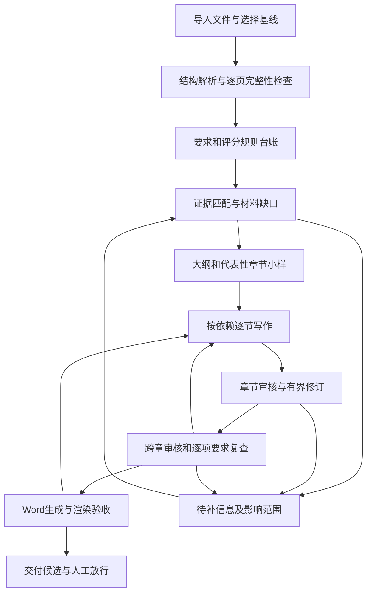

# 标书 Agent 整体方案评估与落地建议

调研日期：2026-11-12。本文是方案研究和建议，不代表系统已实现或已经通过真实标书验收。

## 1. 结论与决策边界

针对“长期反复使用、企业资料持续积累、跨会话执行、处理补遗与返工、最终交付 Word”的目标，建议建设独立标书应用。它最明确的潜在优势是减少人工调度、保留可追溯的业务状态、控制版本变更，并提供适合标书工作的界面。

目前不能证明它的正文质量、实际得分或单位交付成本优于经过工程化增强的 Codex＋Skill。两者都可以使用相近的大模型、资料和审核方法，必须经过同材料、同预算的比较才能确认收益。

推荐形态：**自有标书业务系统＋持久化工作流＋受控的模型工具循环＋可替换的执行接口**。应用负责要求、证据、承诺、版本和放行；模型负责理解、检索决策、写作和语义评审。大模型接口作为首个执行通道，Codex SDK/app-server 保留为可选接入方式。

这并不要求自研模型、向量数据库或通用 Agent 运行时。第一版也不需要多个自治 Agent 互相开会。

## 2. 本次调研做了什么，以及没有证明什么

已完成：

- 重新检查当前目录下的 `bid-writer`，阅读规则、脚本和独立复核标准。
- 用两个内存样例验证要求检查器和 Word 章节读取器的具体行为，未改动原脚本。
- 核对 OpenAI 官方 Codex Skill、SDK、非交互调用和应用集成文档。
- 核对 Anthropic 的工作流、上下文组织和 Agent 评估资料。
- 核对 LangGraph 持久化、中断恢复与失败重试文档。
- 核对 Docling、MinerU、pgvector、OpenViking 的一手资料，评估作为组件的适用位置。

限制：当前目录的检索结果只有 Skill 和辅助脚本，没有实际招标文件、企业事实库、历史标书和人工评分数据。因此没有进行真实文件解析对比、模型调用、端到端生成、Word 排版验收或成本基准测试。本文的技术路线是设计建议，运行成本数字为算例，收益需通过真实试点验证。

DeepLearning.AI 的课程/文章页面在网页读取工具中返回 403；通过公开 HTML 读取到了 Andrew Ng 关于评估和错误分析的文章。本文不声称观看了付费课程或验证了课程实验。

## 3. 先纠正比较中的几个前提

### 3.1 Codex＋Skill 本身也属于 Agent 方案

官方文档中的 Skill 可以包含指令、脚本和参考资料；Codex SDK 可以启动、继续和恢复任务；非交互模式提供结构化输出。这意味着 Codex 可以执行多步骤流程，并非只能完成一次性文本生成。[S1][S2][S3]

OpenAI 还提供 app-server 集成面：宿主应用可以拥有自己的界面、业务数据和工具，复用 Codex 的执行循环。**独立产品与复用 Codex 底座可以同时成立。**[S4]

需要更正之前讨论中过强的说法：Skill 效果有限，不能直接推出“提示词已到天花板”“必须 LangGraph”或“多 Agent 必然更好”。

### 3.2 可恢复执行不等于业务闭环

恢复一段会话，不能自动保证：所用证书仍有效、补遗已传播到相关章节、人工修改已保留、审核针对当前版本、导出文件与通过审核的稿件相同。

这些是标书领域的数据模型与约束，需要专门实现；Codex 路线也能补这些能力，补到一定程度后，它就成为一套独立的业务应用。

### 3.3 自动审核不等于自动证明合格

格式正确的 JSON 不代表提取完整；附有引用不代表引用支持承诺；AI 给出高分也不代表评委会给出同样的分数。Structured Outputs 的价值在输出契约，事实与语义正确性仍需要业务验证。[S5]

闭环的实际定义应是：要求有去向、承诺有依据、问题有处理结果、变更有影响分析、交付版本有验收记录。无法解决的事项必须保留为未知或转人工，不能为了完成状态自行放行。

## 4. 四种方案的比较

下表为基于目标和官方能力的工程判断，不是性能测试排名。

| 比较项 | A：现有 Codex＋Skill | B：增强 Codex＋Skill | C：独立应用＋Codex 执行层 | D：独立应用＋直接模型 API |
|---|---|---|---|---|
| 核心形态 | 人在聊天中组织流程 | 增加脚本、外部状态和分任务执行 | 自有业务系统，复用通用执行底座 | 自有业务系统，按节点调用模型和工具 |
| 开始使用成本 | 当前最低 | 增量投入较小 | 要建设业务产品及集成 | 要建设业务产品及执行适配 |
| 人工写作与临场处理 | 灵活 | 灵活且更有条理 | 可设计为随时介入 | 可设计为随时介入 |
| 长期知识和上下文 | 当前主要靠文件和对话 | 可以建设专用存储和上下文包 | 应用拥有，执行层按需获取 | 应用拥有，逐次明确组装 |
| 补遗传播、失效重审 | 依赖执行者遵循约定 | 脚本可强化，仍需统一入口 | 可以由服务强制执行 | 可以由服务强制执行 |
| 非技术人员使用 | 需要熟悉文件与指令 | 仍有学习成本 | 专用界面可降低操作负担 | 专用界面可降低操作负担 |
| 模型调用控制 | 受宿主配置影响 | 能增加调度控制 | 通过已公开的执行接口控制 | 每次请求、重试和路由更直接 |
| 通用文件操作和工具探索 | 现成能力较丰富 | 可直接复用 | 复用底座，减少重复建设 | 需要明确提供工具和边界 |
| 运维与维护责任 | 较低 | 中等 | 业务系统与执行接口都要维护 | 业务系统与模型调用逻辑都要维护 |
| 正文质量是否更好 | 无基准 | 待测 | 待测 | 待测 |

对个人低频写作、资料尚不稳定的阶段，B 的短期投入产出更有吸引力。对用户当前明确的长期专用产品目标，C/D 的产品和流程优势更明显。

建议选择独立应用方向，先采用 D 的有界模型调用；如果文件探索、代码执行或长任务工具循环成为主要开发负担，再验证 C 的执行适配。不要第一阶段同时维护两套生产执行后端。

## 5. 当前 bid-writer：保留什么，补什么

### 5.1 值得迁移的资产

- `SKILL.md:128` 开始的阶段门：基线、要求、证据、小样、章节检查、装配、独立复核。
- `SKILL.md:96` 的防止空泛加厚、重复模板和低质量扩写规则。
- `SKILL.md:112` 的历史项目身份隔离与串稿检查规则。
- `references/independent-review.md` 的审核输入、问题等级、复检与放行标准。
- `quality_scan.py` 中重复段落、内部措辞和项目禁用词扫描，可以成为初级确定性检查器。

这些规则中有大量 DHR、YonBIP HR、特定章节序号和本地 wiki 路径。迁移时应拆成“通用规则＋行业配置＋企业配置＋项目要求”，不能作为所有标书的默认事实。

### 5.2 已验证的工具缺口

| 位置 | 本次证据 | 实际影响 |
|---|---|---|
| `scripts/check_requirements.py:4` | 输入一项实质性要求后，返回状态恒为“待检查”、位置为空 | 它是检查清单生成器，没有验证正文响应 |
| `scripts/file_readers.py:22` | 内存 Word 同时含正文和表格；提取结果只有标题、正文，表格中的“五年服务”消失 | 不能作为招标要求完整读取链路 |

验证输出：

```json
{"probe":"mandatory_checker","result":[{"id":"R1","content":"提供五年服务","status":"待检查","location":""}]}
{"probe":"docx_chapter_reader","extracted":"第一章 技术要求\n正文内容","table_requirement_retained":false}
```

### 5.3 静态检查发现的风险，尚未实测

- `merge_chapters.py:18-23` 只拼接后续文件的正文 XML，未实现跨文档图片关系、样式、编号和分节资源的统一迁移；不适合作为复杂长标书装配的可靠性依据。
- `file_readers.py:63-71` 用文件 MB 大小选择读取策略，没有测量实际文本 token、表格规模和任务需要。
- PDF 路径使用文本提取，没有完整的扫描件 OCR、布局恢复及低置信页面复核机制。
- `quality_scan.py` 能发现文字风险线索，没有实现要求语义响应、事实蕴含和评分审核；它也不覆盖所有页眉页脚和文档对象。
- `classify_files.py` 主要按路径关键词分类；没有形成可核验的来源、版本、有效期和权限元数据。
- 当前扫描到的目录没有模型网关、运行调度器、数据库迁移、上下文编译器、评估样本集或应用入口。

结论：现有资产更适合作为领域规则和工具原型迁移，不能直接作为独立 Agent 的业务内核。

## 6. 产品范围：第一版就保留完整流程

建议第一版范围限定为：单企业、单人使用、本地或单实例部署、以技术标为首个验证卷册，支持一项工程从导入到 Word 交付。这个范围是假设，后续可根据实际材料调整。

“先技术标”不意味着忽略全项目资格或商务条件：解析时仍要识别它们，明确当前卷册是否负责响应、应交给谁、是否阻断总体交付。商业报价和授权承诺由人确认，不由模型自行决定。

必要界面：项目与基线、资料库、要求及响应矩阵、大纲与章节编辑、待补资料、审核问题、版本差异和导出验收。聊天是其中一个操作入口，不是唯一工作界面。

端到端流程：



工作流保证阶段和产物完整；阶段内部允许 Agent 选择检索词、查阅原文、补充材料、选择修订目标。Anthropic 对工作流与 Agent 的区分支持这种分层设计思路，但本项目具体分工是本文建议。[S6]

## 7. 业务数据模型：比 Agent 角色数量更关键

| 对象 | 至少应记录的字段 |
|---|---|
| DocumentRevision | 企业/项目、原文件哈希、来源类型、版本、导入时间、有效范围、取代关系、解析状态 |
| SourceSpan | 文档版本、页码或稳定对象位置、表格行列/图片区域、原文、解析置信与人工修正 |
| Requirement | 稳定编号、原文定位、类型、适用卷册、条件、分值/评分规则、状态、补遗关系 |
| Evidence | 来源片段、所支持事实、产品/版本、有效期、适用条件、确认状态 |
| Decision | 决策内容、范围、确认人/时间、依据、取代的旧决策 |
| SectionTask | 大纲编号、要求集合、依赖、事实约定、证据集合、写作重点、缺口 |
| DraftRevision | 章节正文、父版本、作者类型、输入快照、人工锁定区域、模型配置 |
| Claim | 正文承诺位置、事实/方案/建议类型、数值单位、证据/决策、适用条件 |
| ReviewIssue | 依据、问题位置、严重度、修改建议、状态、复检对象和结果 |
| Run / Event | 阶段、任务标识、尝试次数、费用、输入输出、失败与恢复事件 |
| ReleaseManifest | 交付文件哈希、源章节版本、招标基线、审核记录、渲染记录和未决事项 |

依赖关系先放关系数据库即可，例如“要求—章节”“证据—承诺”“草稿—审核”。当前没有必要引入图数据库。

文档原件、结构化要求、已确认事实、生成草稿不能相互覆盖。用户在界面补充的信息要记录来源和确认状态；聊天中的讨论不能自动升级为正式承诺。

## 8. 上下文与记忆的具体实现

### 8.1 六类信息分别管理

1. 原始证据：原件、结构块、图片和定位，不靠摘要替代。
2. 企业事实：已核验资质、产品、案例等，按有效期和适用范围筛选。
3. 项目约定：本项目范围、术语、架构、工期与已确认承诺。
4. 执行状态：章节、材料缺口、任务依赖和审核问题，以数据库状态恢复工作。
5. 草稿与成果：逐节版本和人工编辑，是可修订产物，不自动成为事实。
6. 可复用经验：写法偏好、错误原因和人工修改经验，经验证后进入候选规则库。

会话日志用于审计和查找历史决策；不持续拼进每次请求。长期经验不能覆盖本次招标要求或当前企业资料。

### 8.2 上下文编译器

每次模型调用前，由程序形成可审计的 ContextManifest：任务类型、企业和项目、基线版本、当前章节/要求、证据与原文定位、相关决策、前置章节的必要约定、待解决问题、参考写法、token 用量、被省略的资料及原因。

推荐顺序：

1. 权限与企业/项目过滤。
2. 当前生效版本、适用产品和确认状态过滤。
3. 精确标识和结构化字段检索；重要条款直接加载原文。
4. 关键词与语义召回，重新排序，补齐父标题、表头和必要相邻内容。
5. 按本任务需求装配，明确区分要求、企业证据、项目决定和写法参考。
6. 检查预算；必需内容放不下就拆任务或继续按需读取，不静默截断。

按需检索、上下文压缩和持久化笔记都有一手工程实践支持；具体预算仍要通过本项目样本测量。[S7]

可用 24k 输入 token 作为一个初始实验配置，而不是最佳值：规则/任务 2k、原始要求 4k、证据 10k、相关约定 3k、审核问题 2k、参考写法 1k、预留工具结果 2k。输出和模型推理预算另外预留，并检查所选 API 的总窗口限制。

评估时对比 12k/24k/48k 等预算，观察事实支撑、遗漏、人工修改时间和费用。不以更长上下文必然更好为前提。

### 8.3 跨章节一致性

把客户名、产品版本、部署方式、范围、工期、服务期、人员、RTO/RPO 等作为可查询的项目约定，记录确认依据。

写作前提供相关约定；写作后提取承诺与前文对比。单中心/同城双活、三年/五年这类矛盾形成具体审核问题。单位、条件和数值可以做程序比对；复杂语义交给审核调用，最终不确定的部分保留待核。

### 8.4 变更与失效

以“服务期从三年改为五年”为例：新补遗入库并确认作用范围 → 新要求版本生效 → 找到依赖章节、实施计划、附件与相关承诺 → 标记旧审核和交付候选失效 → 修订 → 重新审核 → 重建交付清单。

缓存按任务、相关依赖版本、提示词、模型配置和输出契约计算指纹。不要因为无关资料更新就重写整本；依赖识别不能确定时扩大复查范围。所有实际使用的资料要进入依赖记录，避免隐藏依赖。

执行前后核对输入版本；用户修改了正文或补遗在生成期间生效，旧任务结果只能进入候选区，不能覆盖当前版本。人工锁定段落产生明确冲突后再处理。

### 8.5 存储组件选择

建议数据库作为事实、版本、权限和任务状态的主存储；文件或对象存储保存原件与成果；检索索引作为可重建的派生数据。关系数据和大文件备份需保持可恢复的版本对应关系。

LangGraph 的 checkpoint 和跨会话 store 分工清楚，但它们不会自动生成标书业务模型；checkpoint 只保存执行所需引用和小状态，不塞整本文档。[S8]

OpenViking 可作为资源导航和经验检索的候选组件：官方提供目录摘要、概览、原文的分层读取。[S9] 采用它仍需要自建要求编号、证据与承诺关系、补遗影响和放行规则。第一版建议先用自有数据库和检索接口；对相同资料测试它的召回、失效处理、导出和运维成本后，再决定是否接入。不要把聊天自动提炼的记忆直接当企业事实库。

## 9. 文档解析、知识库与历史标书

### 9.1 文档解析不能只追求读出文字

目标结构应保留标题层级、正文顺序、跨页表格及表头、脚注、图片与图注、页眉页脚和原文定位。Word 的稳定块定位与渲染后的页码要分开：排版变化可能改变页码。

Docling 的统一文档模型支持文本、表格、图片、层级、布局和来源信息，可以作为结构层候选。[S10] MinerU 官方也提供 PDF、扫描图像和 Office 解析能力，可作为中文复杂文件的对比候选。[S11] 官方支持格式不能证明对本项目文件的正确率，须实测。

建议选择 30–50 页代表性页面做解析对比，涵盖合并单元格评分表、跨页表格、扫描条款、小字脚注、补遗、图文混排和可编辑 Word。用原图核对条款遗漏、表格关系、数值单位及定位。低置信页、缺页、空白提取和无法识别对象进入异常队列。

解析台账需要记录所有输入页/对象的处理状态，包括失败和未知。不能只对成功抽取的内容计算“100%覆盖”。招标要求提取还要进行独立的原文复查，降低同一提取错误贯穿写作和审核的风险。

### 9.2 知识库初始化

先做来源分类、版本识别、去重、企业/项目权限、产品和生效时间标注，再做结构化提取和检索索引。

资质、人员、案例、产品事实单独建字段；合同与证书能否作为本项目附件使用另设状态。技术说明按标题和语义对象切块，表格保留父标题和表头，不固定按字符数机械切分。

检索先过滤企业、项目、产品、版本、有效期和确认状态，再组合精确标识、关键词、语义召回与重排。BM25 是相关性排序，证书号/型号等仍需归一化字段精确查询。中文词法检索须实测分词与同义词，不默认英文全文检索配置已足够。

PostgreSQL＋pgvector 可以减少第一版独立基础设施数量。pgvector 官方支持精确/近似向量检索，并指出近似检索与过滤的召回问题；实际查询应检查过滤后的召回，不能只看 top-k 数量。[S12]

### 9.3 历史优秀标书

将历史章节拆成“写法参考”和“可核验事实”两条路径。客户名、金额、工期和能力不能随模板迁移。

保留行业、章节类型、产品、年份、人工质量评价、已知评分及其来源。中标结果只能作为弱标签：价格、资格、竞争等也影响中标，不能把整本中标标书的每段都认定为优秀。

用户对一段文字的修改先形成候选经验，标注它适用于当前项目、企业还是通用写作；经复核后再推广，避免把临时偏好写成永久规则。

## 10. 写作、评审、补资料与终止条件

章节任务应明确：对应要求、证据、关键业务动作、表达重点、需要引用的架构决定、不可做的承诺和未解决问题。写作粒度按要求复杂度决定，不固定每节必须写多少字。

审核分三路：确定性检查、逐要求/逐承诺语义检查、人工校准后的质量评审。审核输入需要原文和当前草稿，不能只接受主笔的“已覆盖”结论。

评分按招标评分项表达为有证据的预估区间和扣分风险，保留无法判断；不把 AI 分数称为实际得分。重大风险项设门槛，不能靠文风分或篇幅分抵消。

建议初始每节最多两轮自动内容修订，技术重试另设预算。出现新问题增多、依据不足、相同问题反复、达到费用上限时转人工；保留最后可靠版本。多模型审核可作为实验变量，不预设更独立就一定更准确。[S13]

缺材料时创建结构化请求：缺什么、依据在哪里、影响哪些要求和章节、是否阻断、可接受的材料形式。独立章节继续工作。检索不到不等于企业没有，要求人补充前应先核对同义词、历史版本和可能的附件位置。

对实质性要求，降低措辞不能代替缺失事实或资质。证据不足、确认不能满足、招标含义不清要区分处理。

最终审核同时检查：原始要求覆盖、跨章承诺、附件、人工编辑后的变化、最终 Word 及渲染结果。独立审核仍可能出错，不能承诺“完美”或无人验收。

## 11. 技术架构与运行可靠性

推荐首版组件配置如下，属于实施建议，具体版本在实施时锁定：

| 部分 | 首版建议 | 选择理由 |
|---|---|---|
| 后端 | Python＋FastAPI＋Pydantic | 统一文档处理、结构化契约和服务接口 |
| 业务存储 | PostgreSQL | 要求、版本、任务、问题和事务集中管理 |
| 检索 | pgvector＋中文词法/精确字段检索 | 支持组合检索，先控制部署数量 |
| 文件 | 本地持久目录，定义对象存储接口 | 原件、解析产物、图片、导出和哈希统一寻址 |
| 流程 | LangGraph＋持久化 checkpoint | 复用中断、恢复及任务编排能力 |
| 执行 | 单独 worker＋数据库任务表 | 模型和渲染长任务不占用网页请求生命周期 |
| 模型 | 一个主提供商先跑通，预留统一业务接口 | 控制首版复杂度，再用评估选择路由 |
| 前端 | 项目看板、矩阵、章节编辑和问题处理 | 支撑人机协作与版本检查 |
| 输出 | 结构化文档树→Word 模板→渲染→复核 | 格式与内容分开，保证验收对象一致 |

LangGraph 当前官方文档提供持久化、中断、失败重试机制；恢复可能重执行节点中的部分代码，不能理解为进程从任意机器指令原地继续。[S8][S14][S15]

应用需自行落实：

- 用数据库租约领取任务，心跳、超时和过期回收；状态更新使用版本校验。
- 任务幂等键包括项目、阶段、相关输入版本和配置；同一次确认或重复请求不重复发布成果。
- 模型输出先存候选，校验后提交业务版本，不能由模型直接改放行状态。
- 文件先生成完整临时产物，核验后再登记成品；恢复时核对文件与数据库记录。
- 请求超时后外部模型可能已执行并收费，应用幂等不能保证不发生重复模型费用；记录未知结果并按提供商能力处理。
- 日志保留输入清单、工具调用、token、模型/提示词版本和错误；对敏感原文与密钥分级处理。

向模型暴露少量业务工具，例如查要求、查证据、读原文、提交草稿、提交审核问题和请求补资料。资料中的提示语当作数据，不作为系统指令；跨企业和项目过滤由服务端执行。面向生产写作任务默认无需任意 shell。

本地知识库不等于资料不会外发：使用远程模型时，上下文仍会发送给提供商。保存/删除、区域和模型访问策略应根据实际接口核实，不作“一律不留存”的承诺。[S16]

## 12. 框架和底座如何取舍

| 选项 | 适合负责什么 | 不能替代什么 | 本次建议 |
|---|---|---|---|
| 原生 API＋自写循环 | 有界抽取、写作、审核和明确工具任务 | 中断恢复、业务状态、调度仍需建设 | 用于首版模型网关和任务内部 |
| LangGraph | 阶段图、中断、恢复和状态传递 | 企业事实真实性、业务版本、交付质量 | 推荐作为流程层 |
| Codex SDK/app-server | 复用通用工具循环、会话、执行事件 | 标书领域关系、补遗失效和放行契约 | 可选执行后端，先做小型集成验证 |
| 通用多 Agent 讨论 | 某些独立子任务的并行探索 | 不自动提高事实性或保证一致性 | 首版不作为核心架构 |
| 通用记忆平台 | 资源导航、检索、经验候选 | 不自动提供标书证据链和版本传播 | 通过接口预留，按样本选用 |

Anthropic 建议根据任务逐步增加复杂度，并明确 Agent 的收益伴随延迟与费用代价。[S6] 本方案据此采用“外层可验证流程＋内层有界自主任务”，不要求所有步骤都动态规划。

## 13. 如何公平验证是否优于 Codex＋Skill

### 13.1 建立三组实验

- A：当前 Skill，在人工正常指导下完成任务，作为现状基线。
- B：增强 Codex＋Skill，允许相同的结构化资料、检索、要求矩阵和审核工具。
- D：独立应用＋模型接口，使用同一资料快照与业务目标。

必须比较 D 对 B，而不是只比较 D 对 A。否则提升可能来自新增工具和更好的资料，而不是独立系统本身。

做两类比较：一类尽可能统一模型、输出与费用上限，考察编排差异；一类在相同交付目标下考察各路线的实际最好表现和总成本。无法统一底层模型时明确记录混杂因素，不声称完成纯架构因果验证。

### 13.2 数据集与实验流程

建议起步收集 3 个脱敏项目：2 个开发集，1 个隔离验收集，覆盖结构清楚、材料不足、补遗变更三类情况。每个项目取 8–12 个代表性章节用于迭代，最终至少整本跑一个项目验证装配和跨章问题。这个规模用于发现错误和做方向判断，不足以证明所有行业表现。

由业务人员标注重要要求、来源、允许承诺和已知矛盾，评分答案及未来补遗不能泄漏给初始生成任务。相同输入至少重复 3 次，运行间清理项目状态，不把前次答案或经验带入后次对照。

盲评时随机交换方案顺序，尽量由两名熟悉业务的人独立判断并处理分歧；只有一名评审时说明局限。人工操作要计时，不能给某方案无限追问预算。

### 13.3 指标

| 维度 | 测量方式 |
|---|---|
| 要求提取 | 对人工基准统计召回、误提取、条件和分值关系错误；分风险等级 |
| 证据检索 | 标注需要的证据能否召回；区分资料不存在、解析遗漏和检索失败 |
| 事实支撑 | 抽查承诺是否被正确版本原文支持，不能只统计引用存在 |
| 响应充分性 | 逐评分项审核具体性、可实施性、证据和可定位程度 |
| 重大风险 | 漏要求、无依据硬承诺、串稿、关键矛盾和不可读交付的件数 |
| 稳定性 | 同任务多次的完成率、风险与费用分布，不只看最好一次 |
| 人工负担 | 完成同等验收所需的指导、补资料、核查、修改和排版时间 |
| 修改保留 | 人工锁定段落和已确认决定是否被错误覆盖 |
| 变更响应 | 受影响对象召回、无关重写比例、旧审核误放行数 |
| 恢复能力 | 中断后不丢进度、不重复提交、不混用版本 |
| 文件交付 | 结构、图片、表格、目录、字体、分页与最终版本一致性 |

审核器本身也要测漏报与误报。注入已知错误，包括错误客户、过期证书、三年/五年矛盾、删掉一个表格条件，验证是否发现并准确定位。模型评审用人工校准，允许输出未知。[S13]

### 13.4 建议的试点通过条件

以下为待与真实基线校准的产品目标，不是现有成绩或行业标准：

- 隔离验收集中的已标注关键要求不得漏掉；发现新增问题应回查数据集标注质量。
- 已知串稿、无依据关键承诺和补遗矛盾等注入用例，应阻断交付或明确转人工。
- 中断恢复、补遗失效、人工修改冲突与交付哈希校验用例全部通过。
- D 的重大风险不高于 B，并在同等验收下使人工处理时间中位数降低至少 30%，作为继续投入的初始目标。
- 记录所有失败、人工兜底和等待时间；不能只对成功生成的章节计算质量。

实际中标率作为后续业务观察，不作为唯一损失函数；它包含价格、资格和竞争等其他因素。首期用质量门槛约束下的人工工时、风险、费用和周期共同决策。

## 14. 成本与收益怎么算

一次交付的模型成本：

```text
C_model = Σ(未缓存输入token × 输入单价
          + 缓存输入token × 缓存单价
          + 计费输出token × 输出单价
          + 其他按提供商口径收取的工具/推理费用)
```

需要额外计入 OCR、嵌入/重排、文件处理、存储、运行维护和人工验收。订阅、API、执行接口与缓存的实际账单按所选方案核对；不能把已有订阅视为无限免费调用。

仅供敏感性计算的 token 算例，不是实测：30 节，每节写作输入 20k/输出 3k，审核输入 25k/输出 1.5k；30% 的章节进行一次同规模修订及复审，则约为输入 1.755M、输出 0.1755M token。该数不含招标解析、知识入库、全局审核、工具往返和额外推理，不能直接作为整本报价。

首版应按项目、阶段和尝试统计费用，用缓存、定向修订、候选数和预算上限控制成本。便宜模型先承担哪些任务，由评估选择，不能先把关键抽取质量降下来。

相对 B 的增量收益计算：

```text
每份净收益 = (B人工小时 − D人工小时) × 人工小时价值
             − (D每份运行成本 − B每份运行成本)
             − 增量维护成本的每份分摊

回本份数 = 增量建设成本 ÷ 每份净收益    （净收益必须为正）
```

上述投入和收益均使用实际记录计算，不预设开发耗时或回本份数。

独立系统的收益更可能随复用次数、项目变更频率和交接需求增加。若材料质量很差或项目很少，短期可能是 B 更划算。

## 15. 分阶段落地，按成果决定继续投入

按依赖和可验收成果分阶段推进，业务专家参与材料提供和评审。

| 阶段 | 可验收结果 |
|---|---|
| 0：材料与比较基线 | 脱敏样本、人工要求基准、A/B 记录、解析对比和首批指标 |
| 1：资料、记忆与状态内核 | 文档版本、结构块、企业/项目隔离、要求/证据/决策、上下文清单、任务恢复 |
| 2：写作到修订闭环 | 大纲、小样、逐节写作、问题处理、补资料、依赖传播、人工编辑冲突 |
| 3：整本交付与试点评估 | 全局审核、Word及渲染、交付清单、三组比较、费用和工时报告 |
| 首轮稳定性修复 | 解决代表性文件、恢复和装配中的未知问题 |

首个可检验的端到端样本应包含：要求在表格中、证据版本冲突、缺一个附件、写作中新增补遗、人工锁定段落和任务重启。即使只覆盖少量章节，也要经过全部阶段；之后再增加篇幅和项目类型。

工程目录可以组织为领域数据、文件解析、检索与上下文、工作流、模型适配、文档装配、评估和 UI。通过少量明确接口连接，避免把全部流程写进一个巨大的提示词。

## 16. 应当提前接受的限制与停止投资条件

- 没有可用企业证据时，系统无法凭流程补出真实资质和案例；收益可能首先来自整理材料。
- 工具化流程能限制错误传播，不能保证模型每次理解正确。以“完美闭环”为目标时，要把未知和人工处理也设计成合法终态。
- 若增强 Codex 方案在真实样本中已经满足工时、风险和使用要求，独立系统的增量价值会缩小。
- 若人工编辑保留、补遗失效或复杂 Word 装配不能可靠完成，不应以自动评分高为由进入正式交付。
- 若两轮真实项目试点后，独立系统仍不减少人工时间，也没有其他已验证的业务收益，应缩减自动化范围或复用更多现成底座。

现在可以确定独立应用的建设方向；下一项投入应是固定真实材料、建立比较基线和验证业务内核，而不是先建设庞大的多 Agent 框架。

## 17. 来源与核实说明

以下均为项目方/作者的一手资料。资料证明组件能力与设计原则，不证明它们在用户标书上的效果。网页功能会变化，实施时应再次核对并锁定版本。

- [S1：OpenAI Build skills](https://learn.chatgpt.com/docs/build-skills)：Skill 的组成与调用机制。
- [S2：OpenAI Codex SDK](https://learn.chatgpt.com/docs/codex-sdk)：程序化启动、继续、恢复任务。
- [S3：OpenAI Non-interactive mode](https://learn.chatgpt.com/docs/non-interactive-mode)：结构化输出与自动化调用。
- [S4：OpenAI Codex as a platform](https://developers.openai.com/blog/codex-as-a-platform)：独立产品复用执行底座的边界。
- [S5：OpenAI Structured model outputs](https://developers.openai.com/api/docs/guides/structured-outputs)：输出契约与局限。
- [S6：Anthropic Building effective agents](https://www.anthropic.com/research/building-effective-agents)：工作流/Agent 的区分、复杂度取舍。文章发表于 2024-12-19，并提示部分工具信息已变化，本文仅采用其架构原则。
- [S7：Anthropic Effective context engineering](https://www.anthropic.com/research/effective-context-engineering-for-ai-agents)：按需上下文与长任务组织。
- [S8：LangGraph Persistence](https://docs.langchain.com/oss/python/langgraph/persistence)：checkpoint 与 store 的不同职责。
- [S9：OpenViking Context Layers](https://docs.openviking.ai/en/concepts/03-context-layers)：目录级摘要、概览与原文分层读取。
- [S10：Docling Document](https://docling-project.github.io/docling/concepts/docling_document/)：统一结构与来源信息。
- [S11：MinerU 官方仓库](https://github.com/opendatalab/MinerU)：多格式解析候选。本文未据此宣布解析正确率或适用许可结论。
- [S12：pgvector 官方仓库](https://github.com/pgvector/pgvector)：向量检索与过滤行为。
- [S13：Anthropic Demystifying evals](https://www.anthropic.com/research/demystifying-evals-for-ai-agents)：多次运行、评审校准与结果验证。
- [S14：LangGraph Interrupts](https://docs.langchain.com/oss/python/langgraph/interrupts)：等待输入与恢复时的节点执行语义。
- [S15：LangGraph Fault tolerance](https://docs.langchain.com/oss/python/langgraph/fault-tolerance)：重试、超时与幂等边界。
- [S16：OpenAI Data controls](https://developers.openai.com/api/docs/guides/your-data)：API 数据处理需按具体能力核实。
- [S17：Andrew Ng：Evals and Error Analysis, Part 1](https://www.deeplearning.ai/the-batch/improve-agentic-performance-with-evals-and-error-analysis-part-1)：用评估和错误分析安排改进工作；本次通过公开 HTML 读取，网页读取工具返回 403。

本地依据：`../bid-writer/SKILL.md`、`../bid-writer/scripts/`、`../bid-writer/references/independent-review.md`。静态风险与两项实际探针结果已在第 5 节分开说明。
